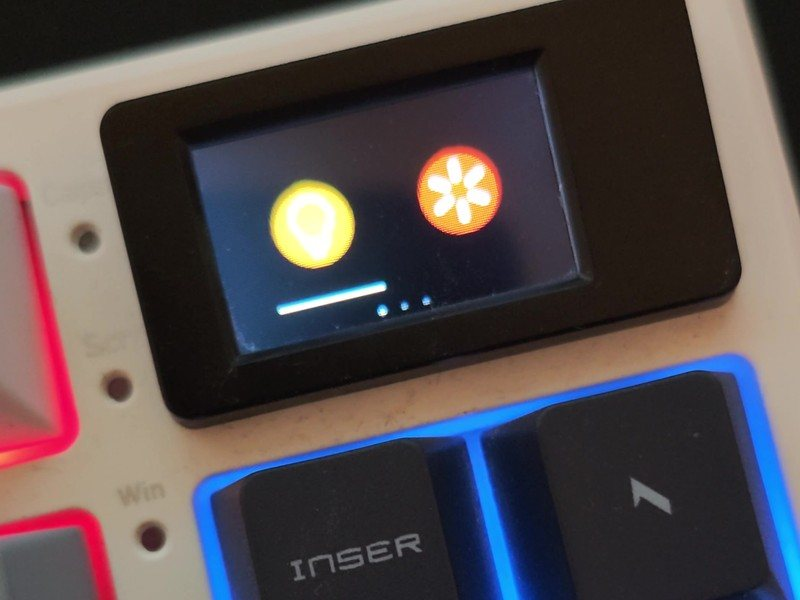
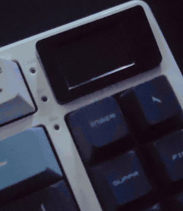

# MSI Forge GK600 TKL Wireless : vos GIF, votre image d'accueil et votre animation de démarrage en USB

🇬🇧 **[Read in English](README.md)**

Le **MSI Forge GK600 TKL Wireless** a un petit écran de 160 × 96. MSI le vend « sans logiciel » :
d'origine, vous n'avez que les animations intégrées. Avec le logiciel de MSI (après une
correction d'une ligne) et les outils gratuits de ce dépôt, vous pouvez :

- afficher **vos propres GIF** sur l'écran et régler le **RGB touche par touche**,
- remplacer l'**image de l'écran d'accueil** (Lucky, le dragon de MSI),
- remplacer l'**animation de démarrage MSI**,
- **réparer** les menus de l'écran effacés par un GIF trop long,
- utiliser le logiciel MSI **en français**.

Tout passe par le câble USB : **rien à ouvrir, aucun flashage de firmware, et tout est
réversible.**

<table>
  <tr>
    <td align="center"> <b>Votre GIF</b></td>
    <td align="center"> <b>Votre image d'accueil</b></td>
  </tr>
  <tr>
    <td align="center"> <b>Votre animation de démarrage</b></td>
    <td align="center"> <b>Les menus d'origine, réparés</b></td>
  </tr>
</table>

## En vidéo

Allumage avec une animation de démarrage personnelle : l'écran s'allume, l'animation se joue
(environ 6,5 secondes), puis l'écran d'accueil affiche une image personnelle. Filmé le
22 novembre 2026 sur un GK600 en firmware V1.20. [Version MP4 (11 s)](images/boot-animation-demo.mp4)

---

## Que voulez-vous faire ?

| Je veux… | Comment | Durée | Guide |
|---|---|---|---|
| afficher mes GIF, régler le RGB touche par touche | corriger une ligne du `config.xml` du logiciel MSI | 15 min | [Tuto](tuto-gk600-gif-usb.md) · [Tutorial (EN)](tutorial-gk600-gif-usb.md) |
| avoir le logiciel MSI en français | double-cliquer sur `traduction-fr/INSTALLER_FR.bat` | 1 min | [traduction-fr](traduction-fr/README.md) |
| réparer des menus noirs ou brouillés, ou un logo MSI noir | double-cliquer sur `restauration/GK600-Repair.bat` | 3 min | [Réparer](restauration/README.md#fr-repair) |
| remplacer l'image de l'écran d'accueil | glisser une image PNG ou JPG sur `restauration/GK600-Home-Picture.bat` | 1 min | [Image d'accueil](restauration/README.md#fr-home) |
| remplacer l'animation de démarrage | glisser un GIF sur `restauration/GK600-Boot-Animation.bat` | 1 à 3 min | [Animation de démarrage](restauration/README.md#fr-boot) |
| revenir à l'écran d'origine | double-cliquer sur `restauration/GK600-Repair.bat` | 3 min | [Réparer](restauration/README.md#fr-repair) |

**Récupérer les fichiers :** bouton vert **Code** en haut de cette page → **Download ZIP**, puis
clic droit sur le ZIP → **Extraire tout**. Au premier lancement d'un `.bat` de `restauration/`,
il télécharge aussi un Python portable (rien n'est installé sur votre PC).

## Avant de commencer

- **Testé sur** le GK600 TKL Wireless (USB `0DB0:EA47`) en firmware **V1.04** et **V1.20**. Il
  vous faut un PC sous Windows 10 ou 11. Les outils de l'écran affichent votre version de
  firmware. Sur une autre version, `GK600-Repair.bat` fait d'abord un test réversible de
  3 secondes, et les outils d'image d'accueil et d'animation de démarrage s'arrêtent en vous
  demandant de le lancer.
- Ce sont des outils communautaires **expérimentaux**, non affiliés à MSI : vous les utilisez à
  vos risques. Ils montrent un aperçu ou un essai à blanc avant toute écriture, et
  `GK600-Repair.bat` remet l'écran d'origine.
- **Fermez le logiciel MSI** (icône près de l'horloge comprise) avant d'utiliser les outils de
  l'écran. Branchez le clavier avec son câble, interrupteur sur **filaire**.
- **Ne relevez jamais `gif_maxframes`** dans le `rgb-keyboard.xml` du logiciel MSI. Un GIF
  d'environ 420 images ou plus déborde de la mémoire de l'écran et efface les menus. Restez à
  255 images ou moins (145 ou moins par prudence).

## Comment ça marche

Tout ce que l'écran affiche est rangé dans une puce flash de 16 Mo, en trois zones :

| Zone | Adresses | Contenu |
|---|---|---|
| Menus | `0x000000` – `0x1A0000` | menus, icônes, écran d'accueil (le dragon) |
| Animation de démarrage | `0x1A0000` – `0x3C0000` | un en-tête et jusqu'à 72 images de 160 × 96 |
| Votre GIF | à partir de `0x3C0000` | un en-tête et jusqu'à 255 images |

Le logiciel MSI n'écrit que la zone du GIF. Les outils de `restauration/` utilisent les mêmes
commandes USB pour réécrire les deux autres zones, à partir de la sauvegarde publique d'un GK600
en bon état ([Flonfli](https://github.com/Flonfli/Forge-gk600-tkl-wireless.bin)) et de votre
image ou animation. Le clavier confirme chaque page reçue et affiche « LOADING xx % » pendant
l'envoi. Votre GIF n'est jamais touché.

Matériel, protocole USB, format de l'animation de démarrage et tests :
[TECHNICAL.md](TECHNICAL.md) (en anglais ; l'annexe technique en français est dans
[restauration/RESTAURATION_MENUS.md](restauration/RESTAURATION_MENUS.md#annexe-technique)).

## Questions fréquentes

**L'écran peut-il afficher l'heure, comme le GK600 DUKE ?**
Non. Le firmware du TKL reçoit l'heure du logiciel MSI (bouton « Régler l'heure ») mais ne
l'affiche jamais : le seul effet visible, c'est un retour à l'écran d'accueil.

**Mon GIF a disparu, l'écran d'accueil est revenu.**
Appuyez sur **Fn + ←** ou **Fn + →**. Le logiciel MSI envoie l'heure quand il renvoie ses réglages,
et ça ramène l'écran sur l'accueil.

**MSI Center ne voit pas l'écran.**
C'est normal : utilisez `DeviceDriver.exe`, dans le paquet du logiciel MSI (voir le
[tuto](tuto-gk600-gif-usb.md)).

**Le logiciel n'est plus sur le site de MSI.**
Il est toujours sur le serveur de téléchargement de MSI :
[lien direct](https://download.msi.com/dvr_exe/gear/MSI-FORGE-GK600-Driver-1.0.0.8.zip). Vérifiez
son SHA-256 avec le tuto.

**Windows affiche « Windows a protégé votre PC » quand j'ouvre un `.bat`.**
Cliquez sur **Informations complémentaires → Exécuter quand même**. Les fichiers `.bat` et `.ps1`
sont du texte : ouvrez-les avec le Bloc-notes pour voir ce qu'ils font.

**Peut-on revenir à l'écran d'origine de MSI ?**
Oui : `restauration/GK600-Repair.bat` remet les menus, le dragon et l'animation de démarrage MSI.
Votre GIF reste en place.

**Comment remettre le GIF d'origine de MSI ?**
C'est `0.gif` (160 × 96, 125 images, 40 ms chacune), dans le dossier du logiciel, sous
`gif\MSI FORGE GK600\`. Envoyez-le comme n'importe quel GIF : ses images sont identiques à
l'emplacement GIF d'un clavier sorti d'usine (vérifié avec la sauvegarde de Flonfli). Sans installer
le logiciel, vous pouvez l'extraire de l'installateur avec
[innoextract](https://constexpr.org/innoextract/) (astuce de
[ahmettahaklc](https://github.com/ahmettahaklc)) :
`innoextract --include "app\gif" "MSI FORGE GK600 Driver-1.0.0.8.exe"`

## Contenu du dépôt

| Chemin | Contenu |
|---|---|
| [tuto-gk600-gif-usb.md](tuto-gk600-gif-usb.md) · [tutorial-gk600-gif-usb.md](tutorial-gk600-gif-usb.md) | GIF personnels en USB : guide pas à pas (français · anglais) |
| [restauration/](restauration/) | Outils de l'écran : réparation, image d'accueil, animation de démarrage (français et anglais) |
| [traduction-fr/](traduction-fr/) | Traduction française du logiciel MSI, avec installateur en un clic |
| [TECHNICAL.md](TECHNICAL.md) | Matériel, carte de la mémoire, protocole USB, format de l'animation, tests (en anglais) |
| [images/](images/) | Photos, captures d'écran et vidéo de démonstration |
| [posts/](posts/) | Les messages Reddit qui ont annoncé chaque partie |

## Autres projets

- [MSI-Forge-GK600-Software](https://github.com/ahmettahaklc/MSI-Forge-GK600-Software), par
  ahmettahaklc : un petit panneau de contrôle open source (Windows, Python seul, sans le logiciel
  MSI) pour l'éclairage RGB et l'envoi d'images ou de GIF en USB. Il n'écrit que l'emplacement du
  GIF et limite les GIF à 255 images, comme le logiciel MSI.

## Historique

| Date | Nouveauté |
|---|---|
| 2 octobre 2026 | Guide : le logiciel MSI reconnaît le clavier en USB après une correction d'une ligne (GIF personnels, RGB touche par touche) |
| 18 novembre 2026 | Réparation de l'écran en un double-clic et outil d'image d'accueil, testés en V1.20 |
| 19 novembre 2026 | Réparation complète confirmée sur un clavier abîmé en V1.04 |
| 22 novembre 2026 | Traduction française du logiciel MSI ; animation de démarrage personnelle, testée et filmée en V1.20 |

## Remerciements

- [Flonfli](https://github.com/Flonfli/Forge-gk600-tkl-wireless.bin) pour la sauvegarde publique
  d'un GK600 en bon état : toutes les réécritures partent de là.
- [parsiya](https://github.com/parsiya/f108-pro/blob/main/ai-docs/lcd-upload-investigation.md)
  pour son compte rendu sur l'AULA F108 Pro, qui correspond à ce qui arrive au GK600.
- [ahmettahaklc](https://github.com/ahmettahaklc) pour l'astuce innoextract et la vérification
  indépendante qu'un envoi de GIF normal ne touche que l'emplacement du GIF.
- Tous ceux qui ont testé les outils et donné leur version de firmware.

---

*Projet communautaire d'Iroamstaff, non affilié à MSI ni approuvé par MSI. « MSI » et « Forge »
sont des marques de leurs propriétaires respectifs. Licence : [CC BY 4.0](LICENSE).*
