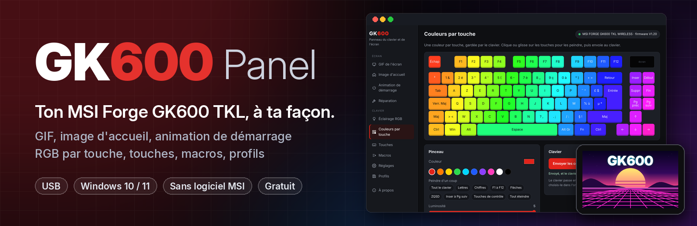
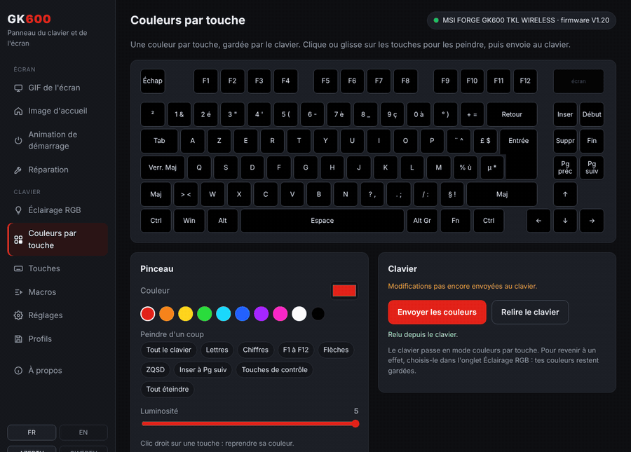
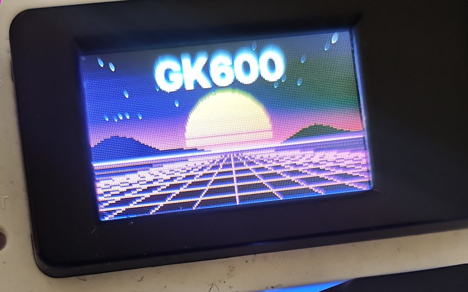
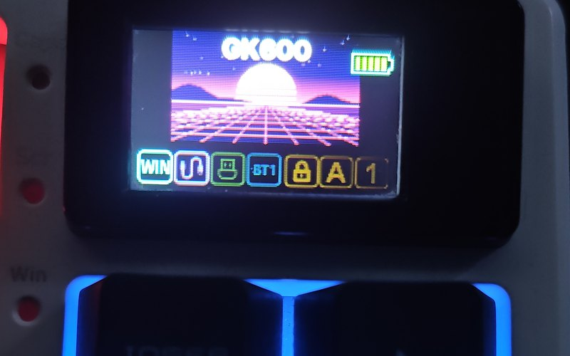
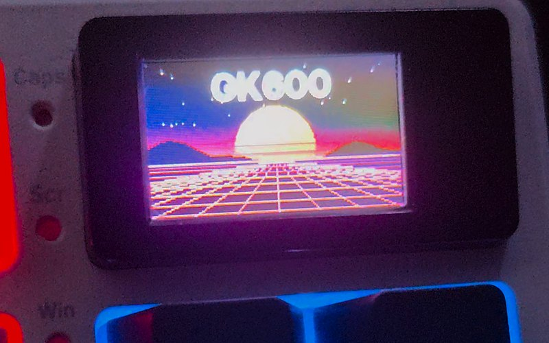
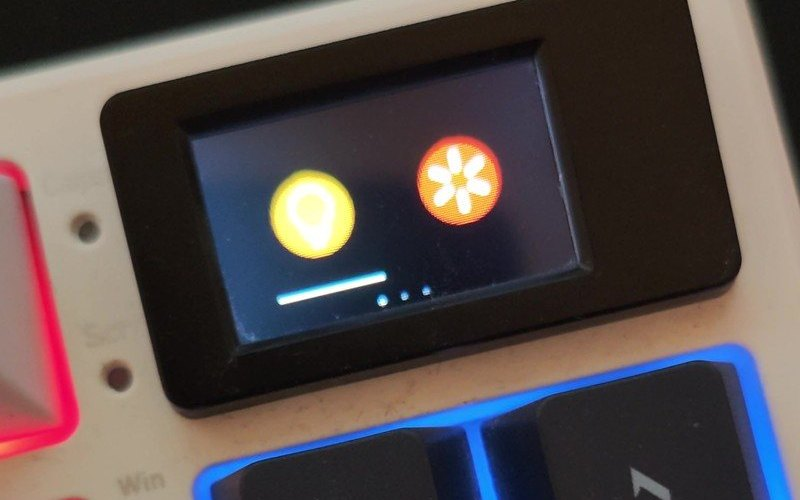
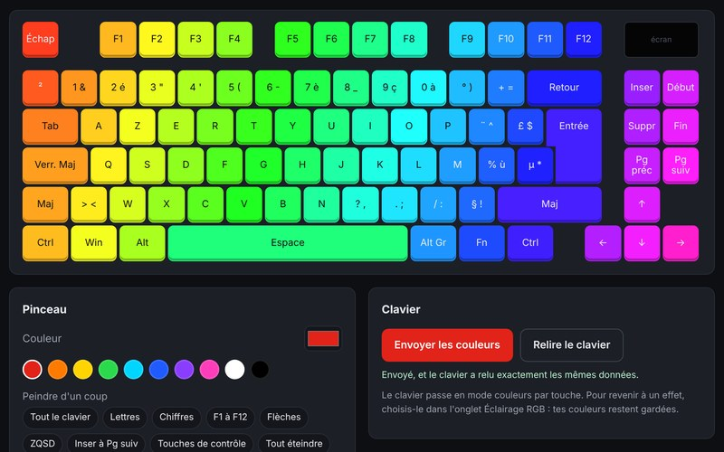
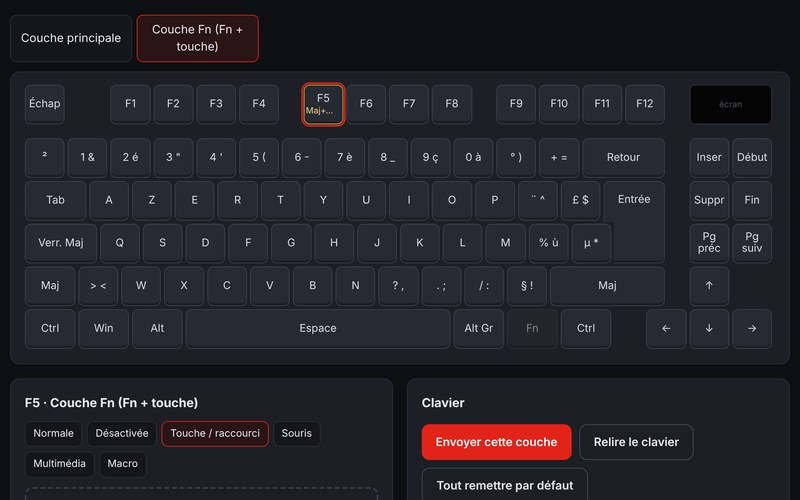
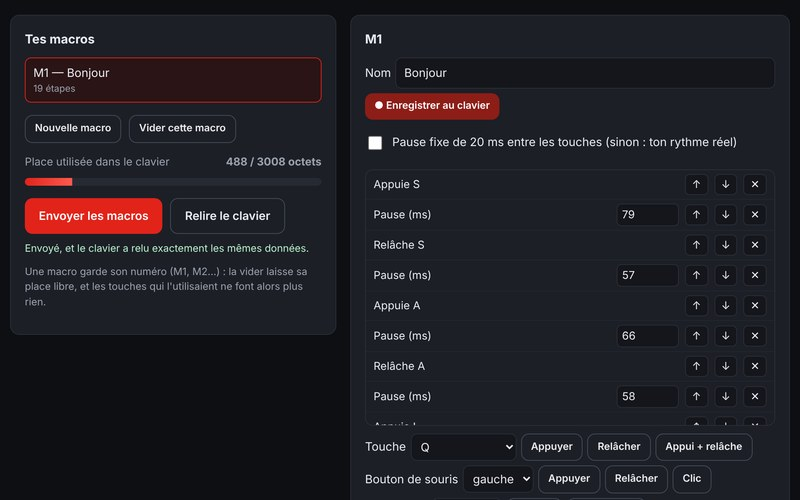
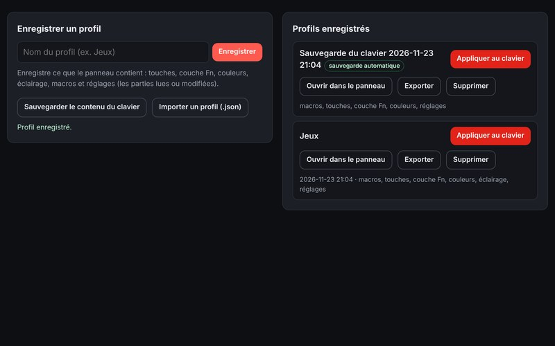

**Vos GIF, votre image d'accueil et votre animation de démarrage sur l'écran, plus le RGB touche
par touche, les touches et les macros du MSI Forge GK600 TKL Wireless. En USB, dans une seule
fenêtre, sans le logiciel MSI.**

**[⬇️ Télécharger](https://github.com/Iroamstaff/gk600-tft-gif-usb/archive/refs/heads/main.zip)** ·
[Démarrage](#demarrage) · [Fonctions](#fonctions) · [Sécurité](#securite) · [FAQ](#faq) ·
🇬🇧 [Read in English](README.md)

---

Le MSI Forge GK600 TKL Wireless a un petit écran de 160 × 96 et du RGB touche par touche, mais en
USB, MSI ne vous laisse que ses animations et ses effets d'origine. Ce projet vous rend la main :
un panneau gratuit qui parle au clavier par son câble USB, **sans rien ouvrir, sans flasher de
firmware, et rien qu'on ne puisse annuler**.

  
   Le panneau en action : couleurs par touche, couche Fn, macro enregistrée et GIF prêt pour l'écran.

> [!NOTE]
> **Nouveau, 23 novembre 2026 :** couleurs par touche, touches, macros, réglages et profils, testés
> sur un vrai clavier en firmware V1.20, tout comme l'envoi de GIF. Voir l'[historique](CHANGELOG.md).

## 🚀 Démarrage

1. **[Téléchargez le ZIP](https://github.com/Iroamstaff/gk600-tft-gif-usb/archive/refs/heads/main.zip)**,
   puis clic droit dessus → **Extraire tout**.
2. **Fermez le logiciel MSI** (aussi dans la zone de notification). Branchez le clavier avec son
   **câble USB**, interrupteur sur **filaire**.
3. Ouvrez le dossier `panneau` et **double-cliquez sur `GK600-Panel.bat`**. Le panneau s'ouvre dans
   sa propre fenêtre.

La première fois, le panneau télécharge un Python portable et la sauvegarde qui sert à réparer
l'écran, et vérifie leurs empreintes. Rien n'est installé sur votre PC. Si Windows affiche
« Windows a protégé votre PC », cliquez sur **Informations complémentaires → Exécuter quand même**
(les fichiers `.bat` et `.ps1` sont du texte, lisible dans le Bloc-notes).

**Envie d'essayer tout de suite ?** Glissez [`exemples/gk600-demo.gif`](exemples/) sur l'onglet
**GIF de l'écran**.

## ✨ Fonctions

### Sur l'écran

<table>
  <tr>
    <td width="50%" valign="top">
      
      <h3>🎞️ Vos GIF</h3>
      GIF, PNG, JPG ou WebP : le panneau l'adapte, vous montre un aperçu, puis l'écrit en une à deux
      minutes. Jusqu'à 255 images. Seul l'emplacement du GIF est écrit.
    </td>
    <td width="50%" valign="top">
      
      <h3>🏠 Votre image d'accueil</h3>
      Remplacez Lucky, le dragon de MSI, par votre image au-dessus des icônes d'état. Remettez-le
      quand vous voulez.
    </td>
  </tr>
  <tr>
    <td width="50%" valign="top">
      
      <h3>⚡ Votre animation de démarrage</h3>
      Votre animation à l'allumage à la place de celle de MSI, jusqu'à 72 images, en gardant votre
      image d'accueil.
    </td>
    <td width="50%" valign="top">
      
      <h3>🛠️ Réparation</h3>
      Menus noirs ou remplis d'images après un GIF trop long ? Un clic remet les menus, le dragon et
      l'animation MSI.
    </td>
  </tr>
</table>

Photos d'un vrai GK600 en firmware V1.20.

### Sur le clavier

<table>
  <tr>
    <td width="50%" valign="top">
      
      <h3>🌈 RGB touche par touche et effets</h3>
      Peignez chaque touche d'un clic ou en glissant, ou choisissez l'un des 20 effets avec sa
      couleur, sa vitesse et sa luminosité.
    </td>
    <td width="50%" valign="top">
      
      <h3>⌨️ Touches et couche Fn</h3>
      Donnez à une touche (ou à Fn + touche) une autre touche, un raccourci, un clic, une touche
      multimédia ou une macro, ou désactivez-la.
    </td>
  </tr>
  <tr>
    <td width="50%" valign="top">
      
      <h3>🎬 Macros</h3>
      Enregistrées en tapant, tout simplement, ou construites pas à pas : touches, clics, pauses,
      100 emplacements, gardés dans le clavier lui-même.
    </td>
    <td width="50%" valign="top">
      
      <h3>💾 Profils et réglages</h3>
      Enregistrez et changez de configuration en un clic, exportez-la en fichier. Bloquez la touche
      Windows, Alt + Tab ou Alt + F4, réglez Fn et la mise en veille.
    </td>
  </tr>
</table>

Vos réglages sont gardés dans le clavier : ils marchent sur n'importe quel PC, même sans le
panneau.

## 🛡️ Pensé pour la sécurité

- **Aperçu d'abord.** Chaque fichier montre exactement ce que l'écran affichera, avant toute
  écriture.
- **Chaque envoi est vérifié.** Le clavier relit ce qu'il a enregistré et renvoie une somme de
  contrôle ; le panneau n'affiche « envoyé » que si elle est exacte, sinon il relit et compare.
- **Sauvegarde automatique.** Avant la première modification, le panneau enregistre le contenu de
  votre clavier. Un clic sur « Appliquer » remet tout comme avant.
- **Aucun flashage.** Le firmware n'est jamais touché. Les changements de l'écran s'annulent
  toujours par la réparation, à partir de la sauvegarde publique d'un GK600 en bon état.
- **En local.** Le panneau tourne sur votre PC (127.0.0.1) et seule sa propre fenêtre peut s'en
  servir : aucun site web ne peut piloter votre clavier.
- **Testé.** Sur de vrais claviers (firmware V1.04 et V1.20), et face au vrai code du firmware du
  clavier dans un émulateur : 179 vérifications automatiques rien que pour le panneau, tests de
  chaque onglet dans un navigateur compris.

## ✅ Compatibilité

| Clavier | Firmware | État |
|---|---|---|
| MSI Forge GK600 TKL Wireless (USB `0DB0:EA47`) | **V1.20** | ✅ Panneau testé sur un vrai clavier : onglets du clavier et GIF. Image d'accueil, animation de démarrage et réparation testées avec leurs propres outils. |
| MSI Forge GK600 TKL Wireless | **V1.04** | ✅ Réparation confirmée sur un clavier abîmé. Onglets du clavier pas encore essayés. |
| MSI Forge GK600 TKL Wireless | autre | ⚠️ Pas testé. L'envoi d'un GIF et des réglages du clavier est permis ; la réécriture de l'écran reste bloquée tant que le test réversible de 3 secondes de l'outil de réparation n'est pas passé. |

**Il vous faut :** un PC sous Windows 10 ou 11, le câble USB du clavier (mode filaire), une
connexion internet la première fois, et le logiciel MSI fermé pendant que vous utilisez le
panneau. Le panneau affiche la version de votre firmware dès que le clavier est branché.

## 🧰 Les autres outils du dépôt

Le panneau fait tout, mais chaque partie existe aussi séparément :

| Je veux… | Comment | Guide |
|---|---|---|
| utiliser **le logiciel MSI** en USB (GIF, RGB touche par touche) | corriger une ligne de son `config.xml` | [Tuto](tuto-gk600-gif-usb.md) · [Tutorial EN](tutorial-gk600-gif-usb.md) |
| avoir le logiciel MSI **en français** | double-cliquer sur `traduction-fr/INSTALLER_FR.bat` | [traduction-fr](traduction-fr/README.md) |
| **réparer** les menus de l'écran ou le logo MSI | double-cliquer sur `restauration/GK600-Repair.bat` | [Réparer](restauration/README.md#fr-repair) |
| changer l'**image d'accueil** | glisser une image sur `restauration/GK600-Home-Picture.bat` | [Image d'accueil](restauration/README.md#fr-home) |
| changer l'**animation de démarrage** | glisser un GIF sur `restauration/GK600-Boot-Animation.bat` | [Animation de démarrage](restauration/README.md#fr-boot) |

## 🎥 Sur un vrai clavier

Allumage avec les [fichiers d'exemple](exemples/) en animation de démarrage et en image d'accueil :
l'animation dure environ 4,5 secondes, puis l'écran d'accueil affiche l'image. Filmé le 23 novembre
2026, firmware V1.20. [Version MP4](images/boot-animation-demo.mp4)

## ❓ FAQ

<b>Ai-je encore besoin du logiciel MSI ?</b>

Non. Le panneau parle au clavier tout seul. Gardez le logiciel MSI fermé pendant que vous utilisez
le panneau (il refuse de travailler tant que le logiciel MSI, OpenRGB ou SignalRGB tourne).

<b>Est-ce que je risque de casser mon clavier ?</b>

Le firmware n'est jamais écrit. La mémoire de l'écran peut être réécrite, mais la réparation remet
l'original, et les réglages du clavier ont une sauvegarde automatique. Gardez vos GIF à 255 images
au plus (le panneau l'impose) : un GIF d'environ 420 images ou plus, possible avec le logiciel MSI
si `gif_maxframes` est relevé, déborde de la mémoire de l'écran et efface les menus.

<b>Ça marche sans fil (2,4 GHz ou Bluetooth) ?</b>

Non, le panneau passe par le câble USB, interrupteur sur filaire. Vos réglages restent ensuite dans
le clavier et marchent dans tous les modes.

<b>Mon GIF a disparu et l'écran d'accueil est revenu.</b>

Appuyez sur **Fn + ←** ou **Fn + →** pour passer de l'écran d'accueil au GIF. Le logiciel MSI
revient à l'écran d'accueil chaque fois qu'il envoie ses réglages.

<b>L'écran peut-il afficher l'heure, comme le GK600 DUKE ?</b>

Non. Le firmware du TKL reçoit l'heure mais n'a pas le code pour la dessiner (vérifié en V1.20).

<b>Puis-je revenir à l'écran et aux réglages d'origine ?</b>

Oui. L'onglet **Réparation** remet les menus, le dragon et l'animation MSI ; votre GIF reste. Pour
le clavier, appliquez la sauvegarde automatique dans l'onglet **Profils**.

<b>Comment récupérer le GIF d'origine de MSI ?</b>

C'est `0.gif` (160 × 96, 125 images de 40 ms), dans le dossier du logiciel MSI sous
`gif\MSI FORGE GK600\` : envoyez-le comme n'importe quel GIF. Sans installer le logiciel, extrayez-le
avec [innoextract](https://constexpr.org/innoextract/) (astuce d'[ahmettahaklc](https://github.com/ahmettahaklc)) :
`innoextract --include "app\gif" "MSI FORGE GK600 Driver-1.0.0.8.exe"`

<b>Le logiciel MSI a disparu du site de MSI.</b>

Il est toujours sur le serveur de téléchargement de MSI :
[lien direct](https://download.msi.com/dvr_exe/gear/MSI-FORGE-GK600-Driver-1.0.0.8.zip). Le
[tuto](tuto-gk600-gif-usb.md) donne son SHA-256 pour le vérifier.

<b>Quelque chose ne marche pas.</b>

[Ouvrez une issue](https://github.com/Iroamstaff/gk600-tft-gif-usb/issues/new/choose) avec la
version de votre firmware (affichée dans le panneau) et le fichier `panneau/gk600_panel.log`.

## 🔬 Comment ça marche

Le panneau est une petite page web locale, avec derrière un programme Python qui parle au clavier
par deux interfaces USB HID. Tout ce qu'affiche l'écran est rangé dans une puce flash de 16 Mo :

| Zone | Adresses | Contenu |
|---|---|---|
| Menus | `0x000000` – `0x1A0000` | menus, icônes, écran d'accueil (le dragon) |
| Animation de démarrage | `0x1A0000` – `0x3C0000` | un en-tête et jusqu'à 72 images de 160 × 96 |
| Votre GIF | à partir de `0x3C0000` | un en-tête et jusqu'à 255 images |

Le logiciel MSI n'écrit que la zone du GIF. Les outils de l'écran utilisent les mêmes commandes USB
pour réécrire les deux autres zones à partir de la sauvegarde publique d'un GK600 en bon état
([Flonfli](https://github.com/Flonfli/Forge-gk600-tkl-wireless.bin)). Touches, couleurs, macros et
réglages utilisent le protocole du logiciel MSI, décodé dans son code et vérifié sur le firmware du
clavier.

Tous les détails (matériel, protocole USB, formats, tests, en anglais) : **[TECHNICAL.md](TECHNICAL.md)**.

<b>Contenu du dépôt</b>

| Chemin | Contenu |
|---|---|
| [panneau/](panneau/README.md) | Le panneau (français et anglais) |
| [restauration/](restauration/README.md) | Les outils de l'écran à part : réparation, image d'accueil, animation de démarrage |
| [traduction-fr/](traduction-fr/README.md) | Traduction française du logiciel MSI, installation en un clic |
| [tuto-gk600-gif-usb.md](tuto-gk600-gif-usb.md) · [tutorial-gk600-gif-usb.md](tutorial-gk600-gif-usb.md) | Le logiciel MSI en USB, pas à pas (français · anglais) |
| [exemples/](exemples/) | Un GIF et une image d'accueil pour essayer le panneau |
| [TECHNICAL.md](TECHNICAL.md) | Matériel, carte de la mémoire, protocole USB, formats, tests (en anglais) |
| [CHANGELOG.md](CHANGELOG.md) | Ce qui a changé, et quand |
| [images/](images/) | Photos, captures et démos |
| [posts/](posts/) | Les messages Reddit qui ont annoncé chaque partie |

## 🤝 Projets liés et remerciements

- [Flonfli](https://github.com/Flonfli/Forge-gk600-tkl-wireless.bin) pour la sauvegarde publique
  d'un GK600 en bon état : toute réécriture de l'écran part d'elle.
- [ahmettahaklc](https://github.com/ahmettahaklc) pour
  [MSI-Forge-GK600-Software](https://github.com/ahmettahaklc/MSI-Forge-GK600-Software), un petit
  panneau open source pour les effets RGB et l'envoi de GIF dont le panneau reprend le protocole
  documenté, pour l'astuce innoextract et pour la vérification indépendante qu'un envoi de GIF
  normal ne touche que son emplacement.
- [parsiya](https://github.com/parsiya/f108-pro/blob/main/ai-docs/lcd-upload-investigation.md) pour
  l'étude de l'AULA F108 Pro, qui correspond à ce qui se passe sur le GK600.
- Tous ceux qui ont testé les outils et donné la version de leur firmware.

Questions, résultats sur votre clavier, idées : les
[issues](https://github.com/Iroamstaff/gk600-tft-gif-usb/issues) sont les bienvenues, en français
ou en anglais.

---

Projet communautaire d'Iroamstaff, non affilié à MSI ni approuvé par MSI. « MSI » et « Forge »
sont des marques de leurs propriétaires respectifs. Utilisation à vos risques. Licence :
[CC BY 4.0](LICENSE) ; le panneau suit un protocole documenté sous licence MIT (voir
[panneau/THIRD_PARTY_NOTICES.md](panneau/THIRD_PARTY_NOTICES.md)).
