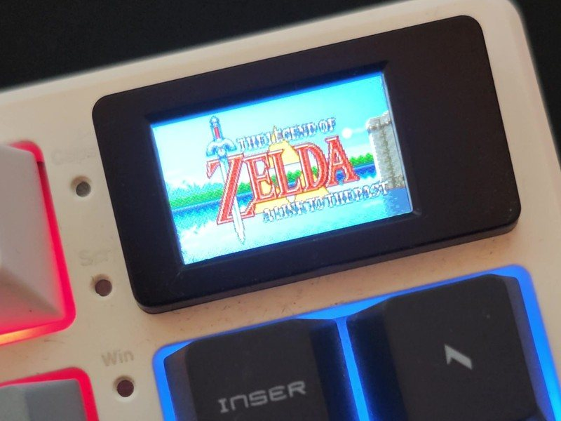
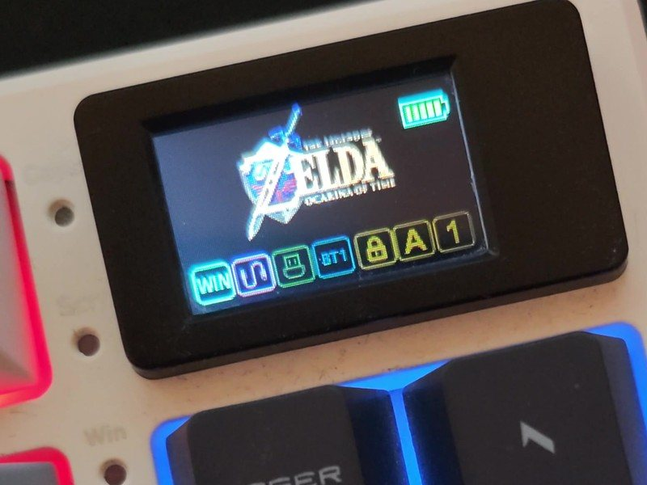
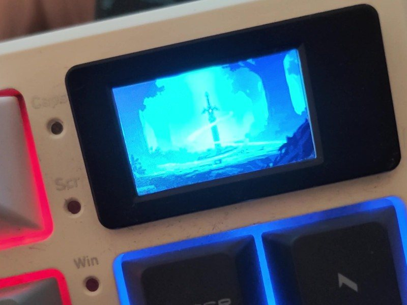
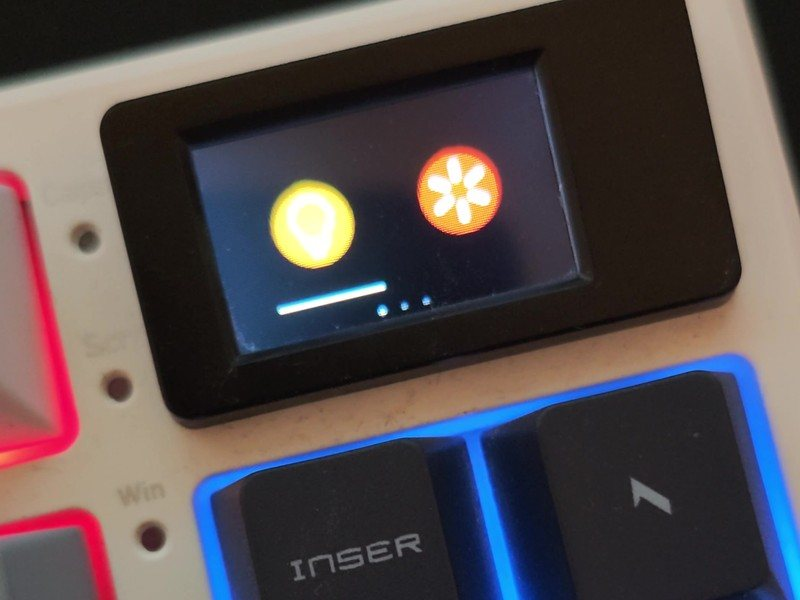
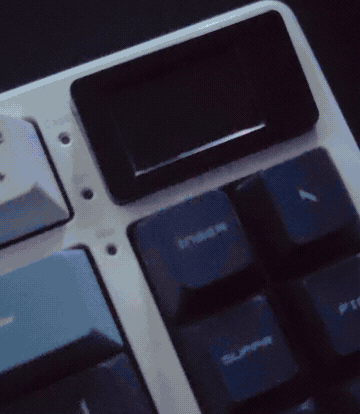

# MSI Forge GK600 TKL Wireless: your own GIFs, home picture and boot animation over USB

🇫🇷 **[Lire en français](README.fr.md)**

The **MSI Forge GK600 TKL Wireless** has a small 160 × 96 screen. MSI sells it as "no software
needed", so out of the box you only get the built-in animations. With MSI's own driver (after a
one-line fix) and the free tools in this repository, you can:

- show **your own GIFs** on the screen and set **per-key RGB**,
- replace the **home-screen picture** (the dragon),
- replace the **MSI boot animation**,
- **repair** screen menus wiped by a GIF that was too long,
- use MSI's software **in French**.

Everything goes through the USB cable: **no opening the keyboard, no firmware flashing, and
everything can be undone.**

<table>
  <tr>
    <td align="center"> <b>Your GIF</b></td>
    <td align="center"> <b>Your home picture</b></td>
  </tr>
  <tr>
    <td align="center"> <b>Your boot animation</b></td>
    <td align="center"> <b>Original menus, repaired</b></td>
  </tr>
</table>

## See it in action

Power-on with a custom boot animation: the screen lights up, the animation plays (about
6.5 seconds), then the home screen shows a custom picture. Filmed on 22 November 2026 on a GK600
running firmware V1.20. [MP4 version (11 s)](images/boot-animation-demo.mp4)

---

## What do you want to do?

| I want to… | How | Time | Guide |
|---|---|---|---|
| show my own GIFs, set per-key RGB | fix one line in the `config.xml` of MSI's driver | 15 min | [Tutorial](tutorial-gk600-gif-usb.md) · [Tuto (FR)](tuto-gk600-gif-usb.md) |
| use MSI's software in French | double-click `traduction-fr/INSTALLER_FR.bat` | 1 min | [traduction-fr](traduction-fr/README.md) |
| repair black or garbled menus, or a black MSI logo | double-click `restauration/GK600-Repair.bat` | 3 min | [Repair](restauration/README.md#en-repair) |
| replace the home-screen picture | drop a PNG or JPG on `restauration/GK600-Home-Picture.bat` | 1 min | [Home picture](restauration/README.md#en-home) |
| replace the boot animation | drop a GIF on `restauration/GK600-Boot-Animation.bat` | 1–3 min | [Boot animation](restauration/README.md#en-boot) |
| go back to the original screen | double-click `restauration/GK600-Repair.bat` | 3 min | [Repair](restauration/README.md#en-repair) |

**Getting the files:** green **Code** button at the top of this page → **Download ZIP**, then
right-click the ZIP → **Extract All**. The first time you run a `.bat` from `restauration/`, it
also downloads a portable Python (nothing gets installed on your PC).

## Before you start

- **Tested on** the GK600 TKL Wireless (USB `0DB0:EA47`) with firmware **V1.04** and **V1.20**.
  You need a Windows 10 or 11 PC. The screen tools show your firmware version. On another
  version, `GK600-Repair.bat` runs a 3-second reversible test first, and the home-picture and
  boot-animation tools stop and ask you to run it.
- These are **experimental** community tools, not affiliated with MSI: use them at your own risk.
  They show a preview or a dry run before writing anything, and `GK600-Repair.bat` puts the
  original screen back.
- **Close MSI's software** (tray icon included) before using the screen tools. Plug the keyboard
  in with its cable, switch on **wired**.
- **Never raise `gif_maxframes`** in MSI's `rgb-keyboard.xml`. A GIF of about 420 frames or more
  overflows the screen's memory and wipes the menus. Keep GIFs at 255 frames or fewer (145 or
  fewer to be extra safe).

## How it works

Everything the screen shows is stored in a 16 MB flash chip, in three areas:

| Area | Addresses | What's there |
|---|---|---|
| Menus | `0x000000` – `0x1A0000` | menus, icons, home screen (the dragon) |
| Boot animation | `0x1A0000` – `0x3C0000` | a header and up to 72 frames of 160 × 96 |
| Your GIF | from `0x3C0000` | a header and up to 255 frames |

MSI's software only writes the GIF area. The tools in `restauration/` use the same USB commands to
rewrite the other two areas, from the public backup of a healthy GK600
([Flonfli](https://github.com/Flonfli/Forge-gk600-tkl-wireless.bin)) plus your picture or
animation. The keyboard acknowledges every page and shows "LOADING xx %" while it receives them.
Your GIF is never touched.

Hardware, USB protocol, boot animation format and tests: [TECHNICAL.md](TECHNICAL.md).

## FAQ

**Can the screen show the time, like the GK600 DUKE?**
No. The TKL firmware receives the time from MSI's software (the "Time Syns" button) but never
draws it: the only visible effect is a jump back to the home screen.

**My GIF is gone and the home screen is back.**
Press **Fn + ←** or **Fn + →**. MSI's software sends the time when it pushes its settings, and that
switches back to the home screen.

**MSI Center doesn't see the screen.**
That's expected: use `DeviceDriver.exe` from MSI's driver package (see the
[tutorial](tutorial-gk600-gif-usb.md)).

**The driver is gone from MSI's website.**
It's still on MSI's download server:
[direct link](https://download.msi.com/dvr_exe/gear/MSI-FORGE-GK600-Driver-1.0.0.8.zip). Check its
SHA-256 with the tutorial.

**Windows shows "Windows protected your PC" when I open a `.bat`.**
Click **More info → Run anyway**. The `.bat` and `.ps1` files are plain text: open them with
Notepad to see what they do.

**Can I go back to MSI's original screen?**
Yes: `restauration/GK600-Repair.bat` puts back the menus, the dragon and the MSI boot animation.
Your GIF stays where it is.

## What's in this repository

| Path | What it is |
|---|---|
| [tutorial-gk600-gif-usb.md](tutorial-gk600-gif-usb.md) · [tuto-gk600-gif-usb.md](tuto-gk600-gif-usb.md) | Custom GIFs over USB: step-by-step guide (English · French) |
| [restauration/](restauration/) | Screen tools: repair, home picture, boot animation (French and English) |
| [traduction-fr/](traduction-fr/) | French translation of MSI's software, with a one-click installer |
| [TECHNICAL.md](TECHNICAL.md) | Hardware, flash map, USB protocol, boot animation format, tests |
| [images/](images/) | Photos, screenshots and the demo video |
| [posts/](posts/) | The Reddit posts that announced each part |

## History

| Date | What's new |
|---|---|
| 2 October 2026 | Guide: MSI's driver detects the keyboard over USB after a one-line fix (custom GIFs, per-key RGB) |
| 18 November 2026 | One-click screen repair and home-picture tool, tested on V1.20 |
| 19 November 2026 | Full repair confirmed on a damaged keyboard running V1.04 |
| 22 November 2026 | French translation of MSI's software; custom boot animation, tested and filmed on V1.20 |

## Credits

- [Flonfli](https://github.com/Flonfli/Forge-gk600-tkl-wireless.bin) for the public backup of a
  healthy GK600: every rewrite starts from it.
- [parsiya](https://github.com/parsiya/f108-pro/blob/main/ai-docs/lcd-upload-investigation.md) for
  the AULA F108 Pro write-up, which matches what happens on the GK600.
- Everyone who tested the tools and reported their firmware version.

---

*Community project by Iroamstaff, not affiliated with or endorsed by MSI. "MSI" and "Forge" are
trademarks of their respective owners. Licence: [CC BY 4.0](LICENSE).*
