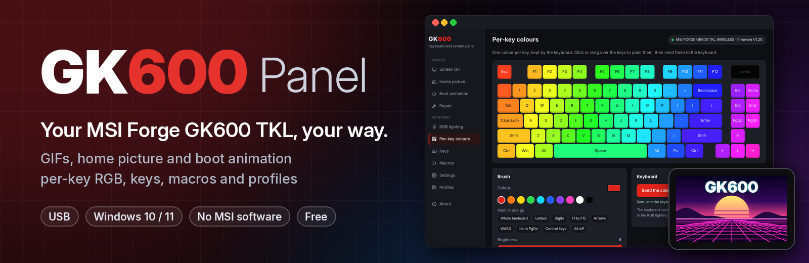
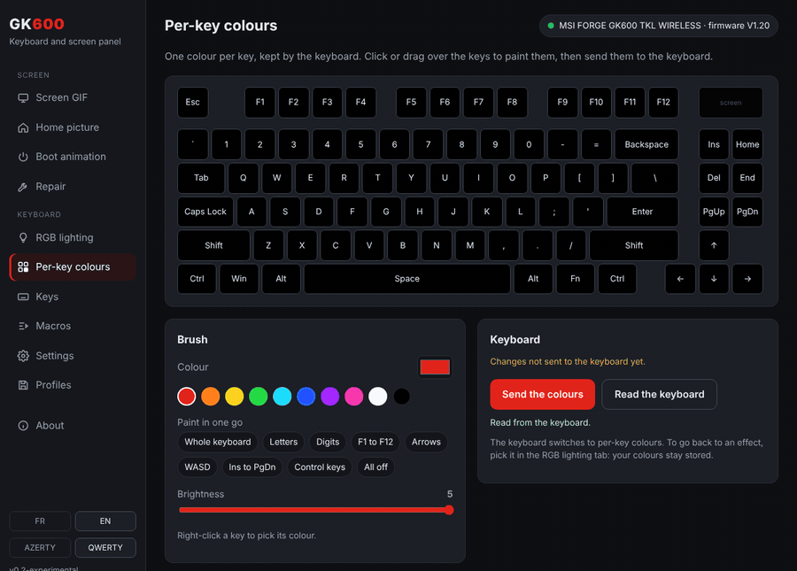
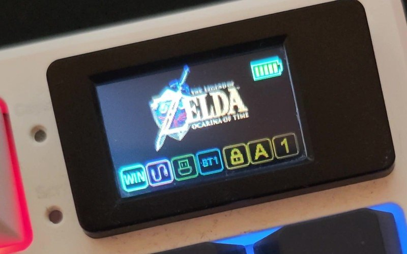
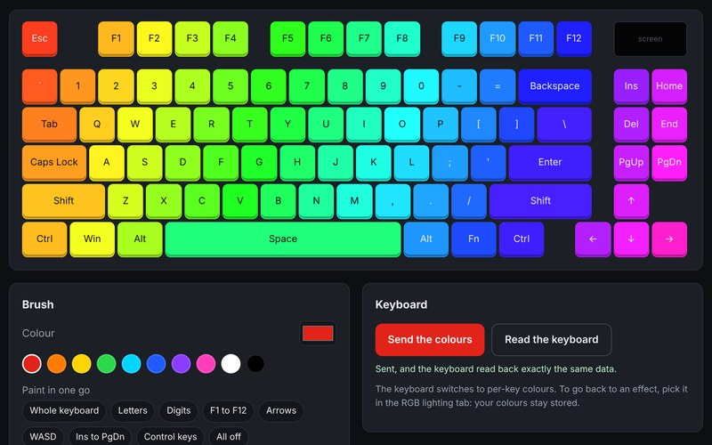
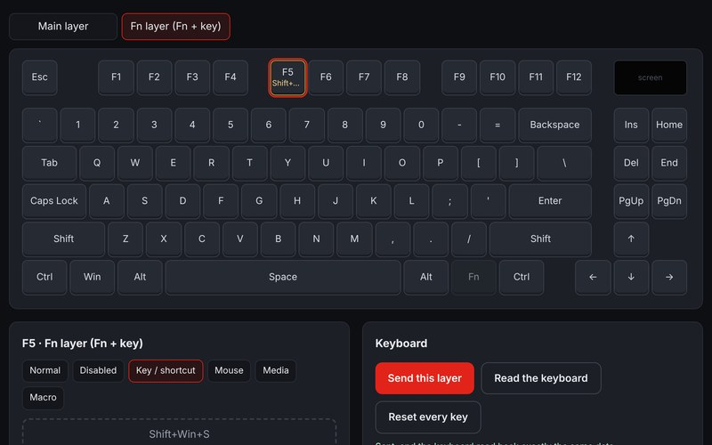
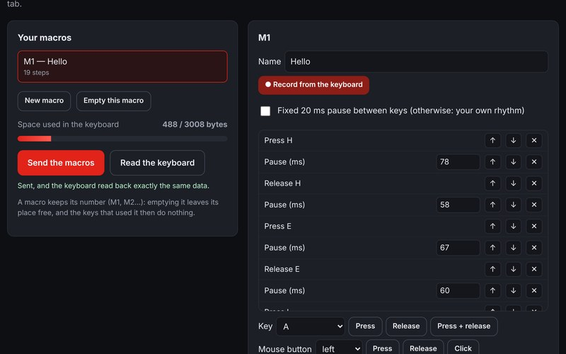
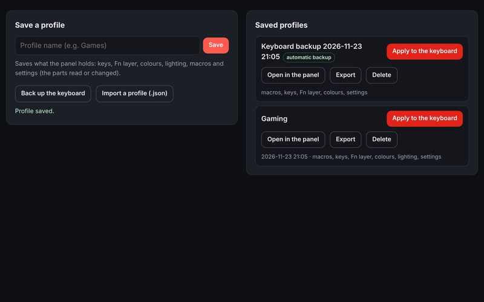

**Your GIFs, home picture and boot animation on the screen, plus per-key RGB, key remapping and
macros for the MSI Forge GK600 TKL Wireless. Over USB, in one window, without MSI's software.**

**[⬇️ Download](https://github.com/Iroamstaff/gk600-tft-gif-usb/archive/refs/heads/main.zip)** ·
[Quick start](#quick-start) · [Features](#features) · [Safety](#safety) · [FAQ](#faq) ·
🇫🇷 [Lire en français](README.fr.md)

---

The MSI Forge GK600 TKL Wireless has a small 160 × 96 screen and per-key RGB, but over USB MSI only
gives you its stock animations and effects. This project puts you in control: a free panel that
talks to the keyboard through its USB cable, with **no opening, no firmware flashing, and nothing
that can't be undone**.

  
   The panel in action: per-key colours, the Fn layer, a recorded macro and a GIF ready for the screen.

> [!NOTE]
> **New, 23 November 2026:** per-key colours, keys, macros, settings and profiles, all tested on a
> real keyboard running firmware V1.20, together with the GIF upload. See the [changelog](CHANGELOG.md).

## 🚀 Quick start

1. **[Download the ZIP](https://github.com/Iroamstaff/gk600-tft-gif-usb/archive/refs/heads/main.zip)**,
   then right-click it → **Extract All**.
2. **Close MSI's software** (check the system tray too). Plug the keyboard in with its **USB cable**,
   switch on **wired**.
3. Open the `panneau` folder and **double-click `GK600-Panel.bat`**. The panel opens in its own
   window.

The first time, the panel downloads a portable Python and the backup it repairs the screen from,
and checks their fingerprints. Nothing gets installed on your PC. If Windows shows "Windows protected
your PC", click **More info → Run anyway** (the `.bat` and `.ps1` files are plain text you can read
in Notepad).

**Want to try right away?** Drop [`exemples/gk600-demo.gif`](exemples/) on the **Screen GIF** tab.

## ✨ Features

### On the screen

<table>
  <tr>
    <td width="50%" valign="top">
      
      <h3>🎞️ Your GIFs</h3>
      Any GIF, PNG, JPG or WebP: the panel resizes it, shows a preview, then writes it in a minute
      or two. Up to 255 frames. Only the GIF slot is written.
    </td>
    <td width="50%" valign="top">
      
      <h3>🏠 Your home picture</h3>
      Replace Lucky, MSI's dragon, with your own picture above the status icons. Put him back
      whenever you like.
    </td>
  </tr>
  <tr>
    <td width="50%" valign="top">
      
      <h3>⚡ Your boot animation</h3>
      Your own animation at power-on instead of MSI's, up to 72 frames, and your home picture is
      kept.
    </td>
    <td width="50%" valign="top">
      
      <h3>🛠️ Repair</h3>
      Menus gone black or full of GIF frames after a too-long GIF? One click puts back the menus,
      the dragon and the MSI animation.
    </td>
  </tr>
</table>

Photos of a real GK600 running firmware V1.20.

### On the keyboard

<table>
  <tr>
    <td width="50%" valign="top">
      
      <h3>🌈 Per-key RGB and effects</h3>
      Paint each key with a click or a drag, or pick one of the 20 effects with its colour, speed
      and brightness.
    </td>
    <td width="50%" valign="top">
      
      <h3>⌨️ Keys and Fn layer</h3>
      Give a key (or Fn + key) another key, a shortcut, a mouse click, a media key or a macro, or
      turn it off.
    </td>
  </tr>
  <tr>
    <td width="50%" valign="top">
      
      <h3>🎬 Macros</h3>
      Record them by simply typing, or build them step by step: keys, clicks and pauses, 100 slots,
      stored in the keyboard itself.
    </td>
    <td width="50%" valign="top">
      
      <h3>💾 Profiles and settings</h3>
      Save and swap whole setups, export them as files. Lock the Windows key, Alt + Tab or Alt + F4,
      set Fn and the sleep delay.
    </td>
  </tr>
</table>

Your settings are stored in the keyboard, so they work on any PC, even without the panel.

## 🛡️ Safe by design

- **Preview first.** Every file shows exactly what the screen will display before anything is
  written.
- **Every write is checked.** The keyboard reads back what it stored and returns a checksum; the
  panel only says "sent" when it matches, otherwise it reads the data back and compares.
- **Automatic backup.** Before the first change, the panel saves what your keyboard holds. One
  click on "Apply" puts everything back.
- **No flashing.** The firmware is never touched. Screen changes can always be undone with the
  repair, from the public backup of a healthy GK600.
- **Local only.** The panel runs on your PC (127.0.0.1) and only its own window can use it: no
  website can drive your keyboard.
- **Tested.** On real keyboards (firmware V1.04 and V1.20), and against the keyboard's real
  firmware code running in an emulator: the panel alone has 179 automated checks, browser tests of
  every tab included.

## ✅ Compatibility

| Keyboard | Firmware | Status |
|---|---|---|
| MSI Forge GK600 TKL Wireless (USB `0DB0:EA47`) | **V1.20** | ✅ Panel tested on a real keyboard: keyboard tabs and GIF. Home picture, boot animation and repair tested with their own tools. |
| MSI Forge GK600 TKL Wireless | **V1.04** | ✅ Repair confirmed on a damaged keyboard. Keyboard tabs not tried yet. |
| MSI Forge GK600 TKL Wireless | other | ⚠️ Not tested. Sending a GIF and keyboard settings is allowed; screen rewrites stay locked until the repair tool's reversible 3-second test passes. |

**You need:** a Windows 10 or 11 PC, the keyboard's USB cable (wired mode), an internet connection
the first time, and MSI's software closed while you use the panel. The panel shows your firmware
version as soon as the keyboard is plugged in.

## 🧰 Other tools in this repository

The panel does everything, but each part also exists on its own:

| I want to… | How | Guide |
|---|---|---|
| use **MSI's own software** over USB (GIFs, per-key RGB) | fix one line in its `config.xml` | [Tutorial](tutorial-gk600-gif-usb.md) · [Tuto FR](tuto-gk600-gif-usb.md) |
| have MSI's software **in French** | double-click `traduction-fr/INSTALLER_FR.bat` | [traduction-fr](traduction-fr/README.md) |
| **repair** the screen menus or the MSI logo | double-click `restauration/GK600-Repair.bat` | [Repair](restauration/README.md#en-repair) |
| change the **home picture** | drop a picture on `restauration/GK600-Home-Picture.bat` | [Home picture](restauration/README.md#en-home) |
| change the **boot animation** | drop a GIF on `restauration/GK600-Boot-Animation.bat` | [Boot animation](restauration/README.md#en-boot) |

## 🎥 On a real keyboard

Power-on with a custom boot animation (about 6.5 seconds), then the home screen with a custom
picture. Filmed on 22 November 2026, firmware V1.20. [MP4 version](images/boot-animation-demo.mp4)

## ❓ FAQ

<b>Do I still need MSI's software?</b>

No. The panel talks to the keyboard on its own. Keep MSI's software closed while you use the panel
(it refuses to work while MSI's software, OpenRGB or SignalRGB is running).

<b>Can it brick my keyboard?</b>

The firmware is never written. The screen's memory can be rewritten, but the repair puts the
original back, and the keyboard settings have an automatic backup. Keep GIFs at 255 frames or fewer
(the panel enforces it): a GIF of about 420 frames or more, possible with MSI's software if
`gif_maxframes` is raised, overflows the screen's memory and wipes the menus.

<b>Does it work wirelessly (2.4 GHz or Bluetooth)?</b>

No, the panel works through the USB cable, switch on wired. Your settings stay in the keyboard and
work in every mode afterwards.

<b>My GIF is gone and the home screen is back.</b>

Press **Fn + ←** or **Fn + →** to switch between the home screen and the GIF. MSI's software
switches back to the home screen every time it pushes its settings.

<b>Can the screen show the time, like the GK600 DUKE?</b>

No. The TKL firmware receives the time but has no code to draw it (checked on V1.20).

<b>Can I go back to MSI's original screen and settings?</b>

Yes. The **Repair** tab puts back the menus, the dragon and the MSI boot animation; your GIF stays.
For the keyboard, apply the automatic backup in the **Profiles** tab.

<b>How do I get MSI's original GIF back?</b>

It's `0.gif` (160 × 96, 125 frames, 40 ms each), in the folder of MSI's driver under
`gif\MSI FORGE GK600\`: send it like any other GIF. Without installing the driver, extract it with
[innoextract](https://constexpr.org/innoextract/) (tip from [ahmettahaklc](https://github.com/ahmettahaklc)):
`innoextract --include "app\gif" "MSI FORGE GK600 Driver-1.0.0.8.exe"`

<b>MSI's driver is gone from MSI's website.</b>

It's still on MSI's download server:
[direct link](https://download.msi.com/dvr_exe/gear/MSI-FORGE-GK600-Driver-1.0.0.8.zip). The
[tutorial](tutorial-gk600-gif-usb.md) gives its SHA-256 so you can check it.

<b>Something went wrong.</b>

[Open an issue](https://github.com/Iroamstaff/gk600-tft-gif-usb/issues/new/choose) with your
firmware version (shown in the panel) and the file `panneau/gk600_panel.log`.

## 🔬 How it works

The panel is a small local web page with a Python program behind it that talks to the keyboard
through two USB HID interfaces. Everything the screen shows sits in a 16 MB flash chip:

| Area | Addresses | Content |
|---|---|---|
| Menus | `0x000000` – `0x1A0000` | menus, icons, home screen (the dragon) |
| Boot animation | `0x1A0000` – `0x3C0000` | a header and up to 72 frames of 160 × 96 |
| Your GIF | from `0x3C0000` | a header and up to 255 frames |

MSI's software only writes the GIF area. The screen tools use the same USB commands to rewrite the
other two areas from the public backup of a healthy GK600
([Flonfli](https://github.com/Flonfli/Forge-gk600-tkl-wireless.bin)). Keys, colours, macros and
settings use the protocol of MSI's own driver, decoded from its code and checked against the
keyboard's firmware.

All the details (hardware, USB protocol, formats, tests): **[TECHNICAL.md](TECHNICAL.md)**.

<b>What's in this repository</b>

| Path | What it is |
|---|---|
| [panneau/](panneau/README.md) | The panel (French and English) |
| [restauration/](restauration/README.md) | Screen tools on their own: repair, home picture, boot animation |
| [traduction-fr/](traduction-fr/README.md) | French translation of MSI's software, one-click installer |
| [tutorial-gk600-gif-usb.md](tutorial-gk600-gif-usb.md) · [tuto-gk600-gif-usb.md](tuto-gk600-gif-usb.md) | MSI's software over USB, step by step (English · French) |
| [exemples/](exemples/) | Sample GIF and home picture to try the panel |
| [TECHNICAL.md](TECHNICAL.md) | Hardware, flash map, USB protocol, formats, tests |
| [CHANGELOG.md](CHANGELOG.md) | What changed, and when |
| [images/](images/) | Photos, screenshots and demos |
| [posts/](posts/) | The Reddit posts that announced each part |

## 🤝 Related projects and credits

- [Flonfli](https://github.com/Flonfli/Forge-gk600-tkl-wireless.bin) for the public backup of a
  healthy GK600: every screen rewrite starts from it.
- [ahmettahaklc](https://github.com/ahmettahaklc) for
  [MSI-Forge-GK600-Software](https://github.com/ahmettahaklc/MSI-Forge-GK600-Software), a small
  open-source panel for RGB effects and GIF upload whose protocol notes the panel builds on, the
  innoextract tip, and an independent check that a normal GIF upload only touches the GIF slot.
- [parsiya](https://github.com/parsiya/f108-pro/blob/main/ai-docs/lcd-upload-investigation.md) for
  the AULA F108 Pro write-up, which matches what happens on the GK600.
- Everyone who tested the tools and reported their firmware version.

Questions, results on your keyboard, ideas: [issues](https://github.com/Iroamstaff/gk600-tft-gif-usb/issues)
are welcome, in English or French.

---

Community project by Iroamstaff, not affiliated with or endorsed by MSI. "MSI" and "Forge" are
trademarks of their respective owners. Use at your own risk. Licence: [CC BY 4.0](LICENSE); the
panel follows a protocol documented under the MIT licence (see
[panneau/THIRD_PARTY_NOTICES.md](panneau/THIRD_PARTY_NOTICES.md)).
