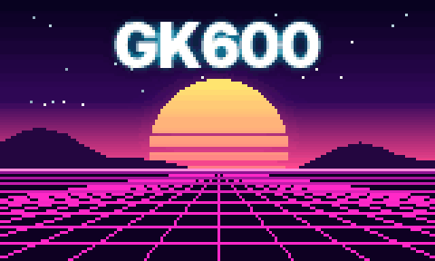
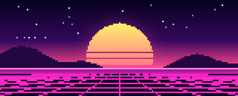

# Exemples · Samples

← [Page principale](../README.fr.md) · [Main page](../README.md)

Deux fichiers pour un premier essai du [panneau](../panneau/README.md), faits pour l'écran du
GK600. Two files for a first try of the [panel](../panneau/README.md), made for the GK600 screen.

| Fichier · File | Taille · Size | Onglet du panneau · Panel tab |
|---|---|---|
| `gk600-demo.gif` | 160 × 96, 48 images · frames | **GIF de l'écran** · **Screen GIF**, ou · or **Animation de démarrage** · **Boot animation** |
| `gk600-demo-home.png` | 160 × 65 | **Image d'accueil** · **Home picture** |

Glissez le fichier sur l'onglet, regardez l'aperçu, puis envoyez-le au clavier. Drop the file on the
tab, check the preview, then send it to the keyboard.

Créés pour ce projet, sous la même licence que le dépôt ([CC BY 4.0](../LICENSE)). Made for this
project, under the same licence as the repository ([CC BY 4.0](../LICENSE)).
