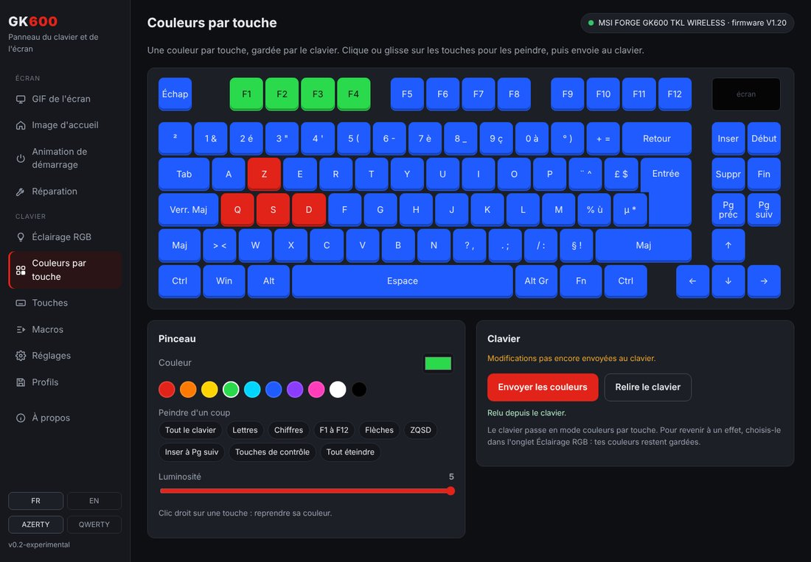
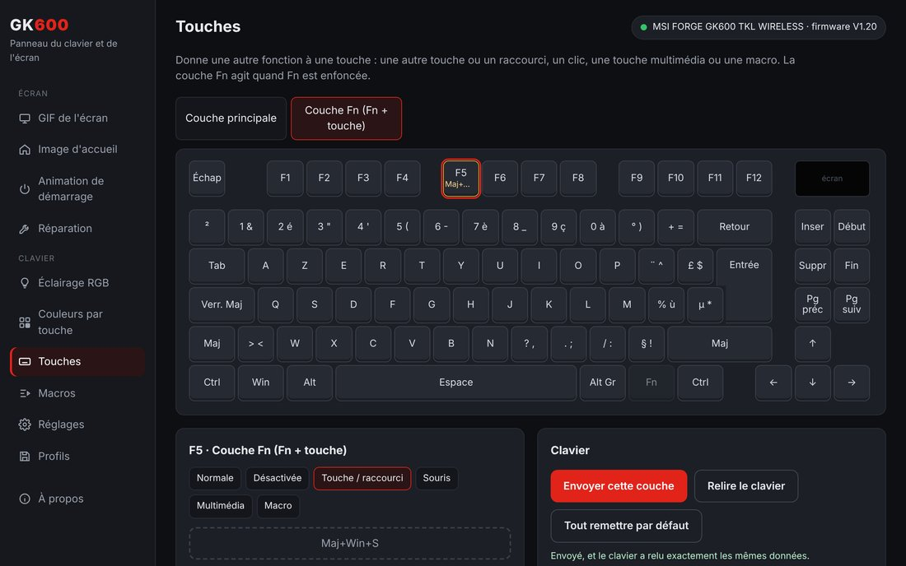
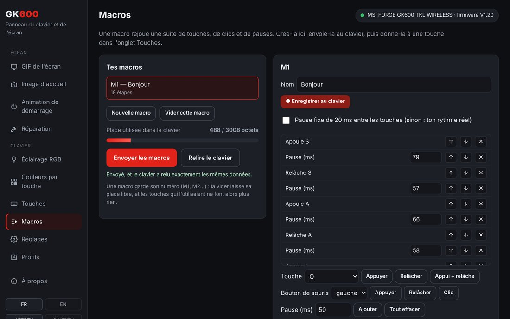
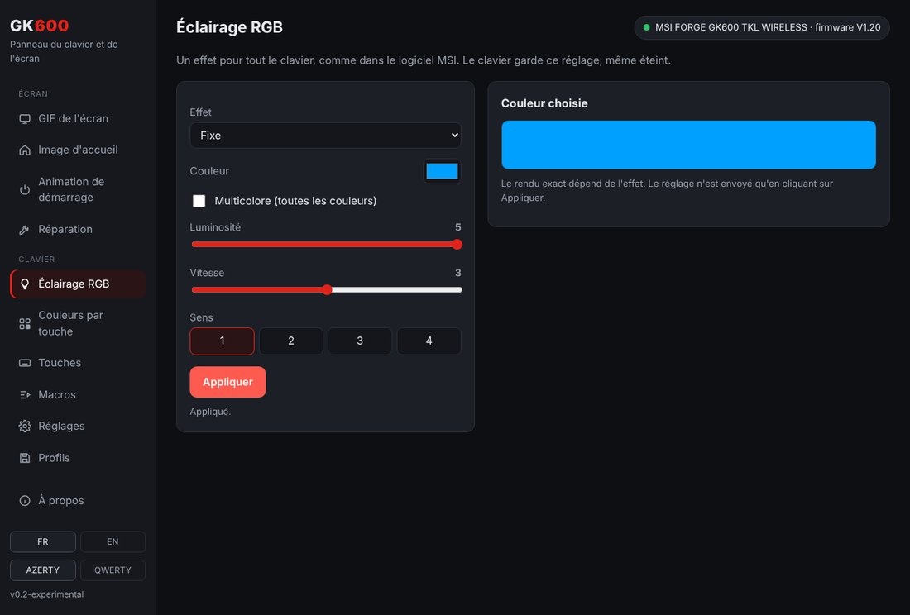

# GK600 — panneau / panel

← [Page principale](../README.fr.md) · [Main page](../README.md)

**Nouveau, expérimental / new, experimental.** Une seule fenêtre pour le MSI Forge GK600 TKL
Wireless, en USB, sans le logiciel MSI : l'écran (GIF, image d'accueil, animation de démarrage,
réparation) et le clavier (effets RGB, couleurs par touche, touches, macros, réglages, profils).
One window for the MSI Forge GK600 TKL Wireless, over USB, without MSI's software: the screen
(GIF, home picture, boot animation, repair) and the keyboard (RGB effects, per-key colours, keys,
macros, settings, profiles).

État / status:

- **Clavier** (effets RGB, couleurs par touche, touches, macros, réglages, profils) : **testé sur
  un vrai GK600 en V1.20** le 23 novembre 2026. Chaque partie a été relue, chaque envoi vérifié par
  le clavier, une macro jouée depuis une touche, la sauvegarde réappliquée. **Keyboard** (RGB
  effects, per-key colours, keys, macros, settings, profiles): **tested on a real GK600 running
  V1.20** on 23 November 2026. Every part read back, every write checked by the keyboard, a macro
  played from a key, the backup applied back.
- **GIF de l'écran** : envoyé par le panneau sur la même V1.20 (110 images, 826 pages, chacune
  confirmée par le clavier), il s'affiche. **Screen GIF**: sent from the panel to the same V1.20
  (110 frames, 826 pages, each one acknowledged by the keyboard), and it plays.
- **Image d'accueil, animation de démarrage** : envoyées par le panneau sur la même V1.20 le
  23 novembre (384 et 784 pages, chacune confirmée par le clavier) ; elles s'affichent et les menus
  restent intacts (photos et vidéo de la page principale). **Home picture, boot animation**: sent
  from the panel to the same V1.20 on 23 November (384 and 784 pages, each one acknowledged by the
  keyboard); they show and the menus stay intact (photos and video on the main page).
- **Réparation** : testée avec le vrai code du firmware en émulation et dans un navigateur ; elle
  reprend le code de l'outil en ligne de commande, qui a servi sur de vrais claviers, mais l'envoi
  par le panneau reste à essayer. **Repair**: tested against the real firmware code in emulation
  and in a browser; it reuses the code of the command-line tool, used on real keyboards, but
  running it from the panel still has to be tried.

<p align="center"></p>

---

## 🇫🇷 Utilisation (Windows)

1. **Téléchargez** ce dépôt : bouton vert **Code** → **Download ZIP**, puis clic droit sur le ZIP
   → **Extraire tout**.
2. **Fermez le logiciel MSI** (aussi dans la zone de notification, près de l'horloge). Branchez le
   clavier avec son **câble USB**, interrupteur sur **filaire**.
3. Ouvrez le dossier `panneau` et **double-cliquez sur `GK600-Panel.bat`**. La première fois, il
   télécharge un Python portable, hidapi, Pillow et la sauvegarde de référence (empreintes
   vérifiées ; rien n'est installé). Le panneau s'ouvre dans sa propre fenêtre. **Gardez la
   fenêtre noire ouverte** tant que vous l'utilisez.

**Écran**

| Onglet | Ce qu'il fait | Écriture |
|---|---|---|
| GIF de l'écran | envoie votre GIF, 255 images au maximum | l'emplacement du GIF seulement, sans redémarrage |
| Image d'accueil | remplace le dragon | 384 pages, après un redémarrage du clavier |
| Animation de démarrage | remplace l'animation MSI | jusqu'à 957 pages, après un redémarrage |
| Réparation | remet les menus, le dragon et l'animation MSI | 960 pages, après un redémarrage |

**Clavier** (réglages gardés par le clavier, même débranché)

| Onglet | Ce qu'il fait |
|---|---|
| Éclairage RGB | 20 effets, couleur ou multicolore, luminosité, vitesse, sens ; ou « couleurs par touche » |
| Couleurs par touche | une couleur par touche : cliquez ou glissez sur le dessin du clavier, palette, groupes en un clic (lettres, ZQSD, F1 à F12, flèches…), clic droit pour reprendre une couleur |
| Touches | couche principale et couche Fn : autre touche ou raccourci (tapé au clavier ou choisi dans une liste), clic ou molette, touche multimédia, macro, ou touche désactivée |
| Macros | 100 macros : enregistrées en tapant (à votre rythme ou 20 ms fixes) ou pas à pas ; touches, clics, pauses ; 3008 octets en tout |
| Réglages | désactiver Windows, Alt + F4, Alt + Tab ; touche Fn en maintien ou en bascule ; mise en veille ; temps de réponse des touches |
| Profils | enregistrer, appliquer, exporter, importer (fichiers `.json`) ; sauvegarde automatique du clavier |

<p align="center"></p>

Bon à savoir :

- Chaque fichier donne un **aperçu** de l'écran avant toute écriture. Pour un premier essai :
  [`exemples/gk600-demo.gif`](../exemples/) (GIF ou animation de démarrage) et
  `exemples/gk600-demo-home.png` (image d'accueil).
- Pour l'image d'accueil, l'animation de démarrage et la réparation, le panneau demande de
  **redémarrer le clavier** (débrancher le câble, éteindre 10 secondes, rallumer, rebrancher). Il
  le voit tout seul et commence l'écriture quand le clavier revient. Pendant l'écriture, l'écran du
  clavier affiche « LOADING xx % ».
- Le panneau **se souvient de votre image d'accueil** : quand vous écrivez ensuite une animation de
  démarrage, il la garde (case cochée par défaut).
- **Firmware non validé** (ni V1.04 ni V1.20) : le GIF et l'éclairage marchent ; l'image
  d'accueil, l'animation et la réparation refusent. Lancez d'abord `restauration\GK600-Repair.bat`,
  qui fait un test réversible.
- Onglets du clavier : le panneau **lit d'abord le clavier**. Avant la première modification, il
  enregistre une **sauvegarde automatique** (profil « Sauvegarde du clavier », onglet Profils) :
  l'appliquer remet le clavier comme avant.
- Chaque envoi est **vérifié** : le clavier renvoie la somme de ce qu'il a relu dans sa mémoire,
  et le panneau n'affiche « envoyé » que si elle est exacte (sinon, il relit ce qu'il a envoyé et le
  compare).
- Comme avec le logiciel MSI, le clavier ne garde **qu'une configuration** : les profils restent
  sur ce PC (dossier `panneau\state\profiles`).
- La touche **Fn** ne peut pas être changée. Une touche laissée « normale » garde aussi ses
  raccourcis Fn d'usine (multimédia, écran…).
- **Macros** : 3008 octets au plus. Le firmware accepte un peu plus, mais le paquet suivant efface
  le début de la couche Fn (vu en émulation) : le panneau s'arrête avant.
- Le dessin est en **AZERTY ISO** (QWERTY : disposition US). La touche < > (numéro 111, pris dans
  le firmware Frieren V1.17) est confirmée sur une V1.20 ; la touche µ * et la touche Début sont
  écrites sous leurs deux numéros possibles.
- Le panneau ne tourne que **sur ce PC** (adresse 127.0.0.1) et seule sa page peut s'en servir
  (jeton aléatoire et vérification de l'origine) : aucun site web ne peut piloter le clavier.
- Fermer la fenêtre du panneau l'arrête au bout de quelques secondes, sauf pendant une écriture.

<p align="center"></p>

## 🇬🇧 How to use (Windows)

1. **Download** this repository: green **Code** button → **Download ZIP**, then right-click the
   ZIP → **Extract All**.
2. **Close MSI's software** (check the system tray too, next to the clock). Plug the keyboard in
   with its **USB cable**, switch set to **wired**.
3. Open the `panneau` folder and **double-click `GK600-Panel.bat`**. The first time, it downloads a
   portable Python, hidapi, Pillow and the reference backup (all hash-checked; nothing gets
   installed). The panel opens in its own window. **Keep the black window open** while you use it.

**Screen**

| Tab | What it does | Write |
|---|---|---|
| Screen GIF | sends your GIF, 255 frames at most | the GIF slot only, no restart |
| Home picture | replaces the dragon | 384 pages, after a keyboard restart |
| Boot animation | replaces the MSI animation | up to 957 pages, after a restart |
| Repair | puts back the menus, the dragon and the MSI animation | 960 pages, after a restart |

**Keyboard** (settings kept by the keyboard, even unplugged)

| Tab | What it does |
|---|---|
| RGB lighting | 20 effects, colour or multicolour, brightness, speed, direction; or "per-key colours" |
| Per-key colours | one colour per key: click or drag over the keyboard picture, palette, one-click groups (letters, WASD, F1 to F12, arrows…), right-click to pick a key's colour |
| Keys | main layer and Fn layer: another key or shortcut (typed on the keyboard or picked from a list), mouse click or wheel, media key, macro, or key disabled |
| Macros | 100 macros: recorded by typing (your own timing or a fixed 20 ms) or step by step; keys, clicks, pauses; 3008 bytes in all |
| Settings | disable Windows, Alt + F4, Alt + Tab; Fn key held or toggled; sleep delay; key response time |
| Profiles | save, apply, export, import (`.json` files); automatic backup of the keyboard |

<p align="center"></p>

Good to know:

- Every file gives a **preview** of the screen before anything is written. For a first try:
  [`exemples/gk600-demo.gif`](../exemples/) (GIF or boot animation) and
  `exemples/gk600-demo-home.png` (home picture).
- For the home picture, the boot animation and the repair, the panel asks you to **restart the
  keyboard** (unplug the cable, switch off for 10 seconds, switch on, plug back). It notices on its
  own and starts writing when the keyboard is back. While writing, the keyboard screen shows
  "LOADING xx %".
- The panel **remembers your home picture**: when you then write a boot animation, it keeps it
  (box ticked by default).
- **Firmware not validated** (neither V1.04 nor V1.20): the GIF and the lighting work; the home
  picture, the boot animation and the repair refuse. Run `restauration\GK600-Repair.bat` first,
  it runs a reversible test.
- Keyboard tabs: the panel **reads the keyboard first**. Before the first change, it saves an
  **automatic backup** (profile "Keyboard backup", Profiles tab): applying it puts the keyboard
  back as it was.
- Every write is **checked**: the keyboard returns the sum of what it read back from its memory,
  and the panel only says "sent" when it matches (otherwise it reads back what it sent and
  compares).
- Like with MSI's software, the keyboard holds **one setup**: profiles stay on this PC
  (`panneau\state\profiles` folder).
- The **Fn** key cannot be changed. A key left "normal" also keeps its factory Fn shortcuts
  (media, screen…).
- **Macros**: 3008 bytes at most. The firmware takes a little more, but the next packet erases the
  start of the Fn layer (seen in emulation): the panel stops before.
- The picture is **AZERTY ISO** (QWERTY: US layout). The < > key (number 111, from the Frieren
  V1.17 firmware) is confirmed on a V1.20; the µ * key and the Home key are written under both of
  their possible numbers.
- The panel only runs **on this PC** (address 127.0.0.1) and only its own page can use it (random
  token and origin check): no website can drive the keyboard.
- Closing the panel window stops it after a few seconds, except during a write.

<p align="center"></p>

---

## Ligne de commande / command line

Python 3.8+, `pip install hidapi pillow`, the reference dump in `../restauration`:

```
python gk600_panel.py                                   # the panel
python gk600_gif.py anim.gif --preview preview.gif      # GIF as the screen will play it
python gk600_gif.py anim.gif --write                    # send it (04 72, GIF slot only)
python gk600_lighting.py list                           # the 20 effects
python gk600_lighting.py static --color 00a0ff --brightness 5
python gk600_lighting.py rolling --multicolour --speed 3
python gk600_config.py read keys                        # main layer (also fnkeys, colours, macros, settings)
python gk600_config.py backup backup.json               # keys, colours, macros, lighting, settings
```

The protocol (blocks, read-back sum, key and macro formats) is in
[TECHNICAL.md](../TECHNICAL.md#keys-macros-colours-and-settings).

## Tests

Sans clavier, avec le vrai code du firmware Frieren V1.17 en émulation (voir
`../restauration/tests`). No keyboard needed: the real Frieren V1.17 firmware code runs in an
emulator (see `../restauration/tests`).

```
python -I tests/test_config.py frieren_v117.bin
python -I tests/test_panel_config.py frieren_v117.bin "Forge gk600 tkl wireless.bin"
python -I tests/test_panel.py frieren_v117.bin "Forge gk600 tkl wireless.bin" anim.gif picture.png
python -I tests/ui_test.py frieren_v117.bin "Forge gk600 tkl wireless.bin" anim.gif picture.png shots/
python -I tests/ui_test_keyboard.py frieren_v117.bin "Forge gk600 tkl wireless.bin" shots/
```

- `test_config.py` (76 checks): every block written the way MSI's software writes it, then read
  back; the firmware's flash pages touched, its sum, its refresh, the per-key mode switch; macros
  up to the 48-packet limit with the Fn layer intact; settings applied in RAM; corrupted packets
  caught, with or without the keyboard's sum; the MCU code and the screen flash never touched.
  Result: [tests/run_test_config.log](tests/run_test_config.log).
- `test_panel_config.py` (30 checks, through the real web server): read, automatic backup, keys,
  colours, macros and settings written and read back, Fn refused, oversized macros refused,
  profiles saved, applied, refused when broken, kept in their folder; the backup puts the factory
  setup back. Result: [tests/run_test_panel_config.log](tests/run_test_panel_config.log).
- `test_panel.py` (34 checks, through the real web server): lighting acknowledged and stored by
  the firmware; GIF slot written exactly, rest of the chip untouched, animation reloaded; home
  picture, boot animation (home picture kept) and repair with the restart step; cancel; MSI's
  software open; unvalidated firmware; Host, Origin and token protections.
  Result: [tests/run_test_panel.log](tests/run_test_panel.log).
- `ui_test.py` (12 checks) and `ui_test_keyboard.py` (27 checks), need Playwright and Chrome: the
  page in a real browser, every tab, painting keys, capturing a shortcut, recording a macro from
  the keyboard, profiles, French and English, AZERTY and QWERTY, a narrow window, no JavaScript
  error. Results: [tests/run_ui_test.log](tests/run_ui_test.log),
  [tests/run_ui_test_keyboard.log](tests/run_ui_test_keyboard.log).

## Fichiers / files

| File | Role |
|---|---|
| `GK600-Panel.bat` | double-click: sets up and starts the panel (through `../restauration/gk600_easy.ps1`) |
| `gk600_panel.py` | the local web server: device access, previews, writes, profiles, protections |
| `gk600_gif.py` | GIF to the screen's GIF slot (04 72) |
| `gk600_lighting.py` | lighting effects (04 13) |
| `gk600_config.py` | keys, Fn layer, per-key colours, macros, settings: write, check, read back |
| `gk600_layout.py` | the keyboard picture (AZERTY ISO, QWERTY ANSI) and what a key can do |
| `web/index.html` | the panel's page (French and English) |
| `tests/` | emulated-keyboard tests, browser tests, their logs |
| `THIRD_PARTY_NOTICES.md` | licence of the code this panel builds on |

## Crédits / credits

- Lighting and GIF upload protocol: the open-source panel
  [MSI-Forge-GK600-Software](https://github.com/ahmettahaklc/MSI-Forge-GK600-Software) by
  ahmettahaklc (MIT licence, see [THIRD_PARTY_NOTICES.md](THIRD_PARTY_NOTICES.md)).
- Keys, macros, per-key colours and settings: read from MSI's own driver (`DeviceDriver.exe`,
  driver 1.0.0.8) and checked on the Frieren V1.17 firmware in an emulator.
- Effect names: MSI's own software (English) and the [French translation](../traduction-fr/).
- Reference backup: [Flonfli](https://github.com/Flonfli/Forge-gk600-tkl-wireless.bin).

*Community tool, not affiliated with MSI. Use at your own risk.*
