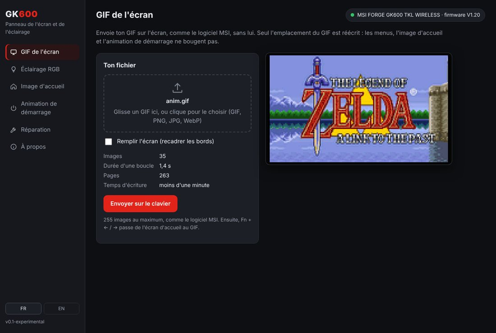
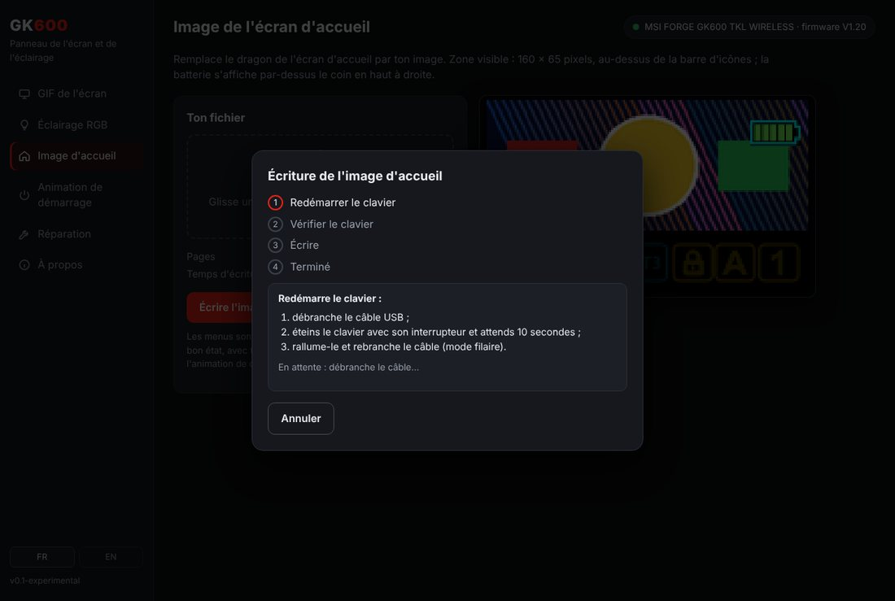

# GK600 — panneau / panel

← [Page principale](../README.fr.md) · [Main page](../README.md)

**Nouveau, expérimental / new, experimental.** Une seule fenêtre pour l'écran et l'éclairage du
MSI Forge GK600 TKL Wireless : ton GIF, les effets RGB, l'image d'accueil, l'animation de démarrage
et la réparation, en USB, sans le logiciel MSI. One window for the screen and the lighting of the
MSI Forge GK600 TKL Wireless: your GIF, the RGB effects, the home picture, the boot animation and
the repair, over USB, without MSI's software.

Testé avec le vrai code du firmware en émulation et dans un navigateur ; premier essai sur un vrai
clavier en cours. Tested against the real firmware code in emulation and in a browser; first try
on a real keyboard in progress.

<p align="center"></p>

---

## 🇫🇷 Utilisation (Windows)

1. **Téléchargez** ce dépôt : bouton vert **Code** → **Download ZIP**, puis clic droit sur le ZIP
   → **Extraire tout**.
2. **Fermez le logiciel MSI** (aussi dans la zone de notification, près de l'horloge). Branchez le
   clavier avec son **câble USB**, interrupteur sur **filaire**.
3. Ouvrez le dossier `panneau` et **double-cliquez sur `GK600-Panel.bat`**. La première fois, il
   télécharge un Python portable, hidapi, Pillow et la sauvegarde de référence (empreintes
   vérifiées ; rien n'est installé). Le panneau s'ouvre dans sa propre fenêtre. **Gardez la
   fenêtre noire ouverte** tant que vous l'utilisez.

| Onglet | Ce qu'il fait | Écriture |
|---|---|---|
| GIF de l'écran | envoie votre GIF, 255 images au maximum | l'emplacement du GIF seulement, sans redémarrage |
| Éclairage RGB | 20 effets, couleur ou multicolore, luminosité, vitesse, sens | réglage gardé par le clavier |
| Image d'accueil | remplace le dragon | 384 pages, après un redémarrage du clavier |
| Animation de démarrage | remplace l'animation MSI | jusqu'à 957 pages, après un redémarrage |
| Réparation | remet les menus, le dragon et l'animation MSI | 960 pages, après un redémarrage |

Bon à savoir :

- Chaque fichier donne un **aperçu** de l'écran avant toute écriture.
- Pour l'image d'accueil, l'animation de démarrage et la réparation, le panneau demande de
  **redémarrer le clavier** (débrancher le câble, éteindre 10 secondes, rallumer, rebrancher). Il
  le voit tout seul et commence l'écriture quand le clavier revient. Pendant l'écriture, l'écran du
  clavier affiche « LOADING xx % ».
- Le panneau **se souvient de votre image d'accueil** : quand vous écrivez ensuite une animation de
  démarrage, il la garde (case cochée par défaut).
- **Firmware non validé** (ni V1.04 ni V1.20) : le GIF et l'éclairage marchent ; l'image
  d'accueil, l'animation et la réparation refusent. Lancez d'abord `restauration\GK600-Repair.bat`,
  qui fait un test réversible.
- Le panneau ne tourne que **sur ce PC** (adresse 127.0.0.1) et seule sa page peut s'en servir
  (jeton aléatoire et vérification de l'origine) : aucun site web ne peut piloter le clavier.
- Fermer la fenêtre du panneau l'arrête au bout de quelques secondes, sauf pendant une écriture.

<p align="center"></p>

## 🇬🇧 How to use (Windows)

1. **Download** this repository: green **Code** button → **Download ZIP**, then right-click the
   ZIP → **Extract All**.
2. **Close MSI's software** (check the system tray too, next to the clock). Plug the keyboard in
   with its **USB cable**, switch set to **wired**.
3. Open the `panneau` folder and **double-click `GK600-Panel.bat`**. The first time, it downloads a
   portable Python, hidapi, Pillow and the reference backup (all hash-checked; nothing gets
   installed). The panel opens in its own window. **Keep the black window open** while you use it.

| Tab | What it does | Write |
|---|---|---|
| Screen GIF | sends your GIF, 255 frames at most | the GIF slot only, no restart |
| RGB lighting | 20 effects, colour or multicolour, brightness, speed, direction | setting kept by the keyboard |
| Home picture | replaces the dragon | 384 pages, after a keyboard restart |
| Boot animation | replaces the MSI animation | up to 957 pages, after a restart |
| Repair | puts back the menus, the dragon and the MSI animation | 960 pages, after a restart |

Good to know:

- Every file gives a **preview** of the screen before anything is written.
- For the home picture, the boot animation and the repair, the panel asks you to **restart the
  keyboard** (unplug the cable, switch off for 10 seconds, switch on, plug back). It notices on its
  own and starts writing when the keyboard is back. While writing, the keyboard screen shows
  "LOADING xx %".
- The panel **remembers your home picture**: when you then write a boot animation, it keeps it
  (box ticked by default).
- **Firmware not validated** (neither V1.04 nor V1.20): the GIF and the lighting work; the home
  picture, the boot animation and the repair refuse. Run `restauration\GK600-Repair.bat` first,
  it runs a reversible test.
- The panel only runs **on this PC** (address 127.0.0.1) and only its own page can use it (random
  token and origin check): no website can drive the keyboard.
- Closing the panel window stops it after a few seconds, except during a write.

<p align="center"></p>

---

## Ligne de commande / command line

Python 3.8+, `pip install hidapi pillow`, the reference dump in `../restauration`:

```
python gk600_panel.py                                   # the panel
python gk600_gif.py anim.gif --preview preview.gif      # GIF as the screen will play it
python gk600_gif.py anim.gif --write                    # send it (04 72, GIF slot only)
python gk600_lighting.py list                           # the 20 effects
python gk600_lighting.py static --color 00a0ff --brightness 5
python gk600_lighting.py rolling --multicolour --speed 3
```

## Tests

Sans clavier, avec le vrai code du firmware Frieren V1.17 en émulation (voir
`../restauration/tests`). No keyboard needed: the real Frieren V1.17 firmware code runs in an
emulator (see `../restauration/tests`).

```
python -I tests/test_panel.py frieren_v117.bin "Forge gk600 tkl wireless.bin" anim.gif picture.png
python -I tests/ui_test.py frieren_v117.bin "Forge gk600 tkl wireless.bin" anim.gif picture.png shots/
```

- `test_panel.py` (34 checks, through the real web server): lighting acknowledged and stored by
  the firmware; GIF slot written exactly, rest of the chip untouched, animation reloaded; home
  picture, boot animation (home picture kept) and repair with the restart step; cancel; MSI's
  software open; unvalidated firmware; Host, Origin and token protections.
  Result: [tests/run_test_panel.log](tests/run_test_panel.log).
- `ui_test.py` (12 checks, needs Playwright and Chrome): the page in a real browser, every tab,
  French and English, no JavaScript error. Result: [tests/run_ui_test.log](tests/run_ui_test.log).

## Fichiers / files

| File | Role |
|---|---|
| `GK600-Panel.bat` | double-click: sets up and starts the panel (through `../restauration/gk600_easy.ps1`) |
| `gk600_panel.py` | the local web server: device access, previews, writes, protections |
| `gk600_gif.py` | GIF to the screen's GIF slot (04 72) |
| `gk600_lighting.py` | lighting effects (04 13) |
| `web/index.html` | the panel's page (French and English) |
| `tests/` | emulated-keyboard tests, browser test, their logs |
| `THIRD_PARTY_NOTICES.md` | licence of the code this panel builds on |

## Crédits / credits

- Lighting and GIF upload protocol: the open-source panel
  [MSI-Forge-GK600-Software](https://github.com/ahmettahaklc/MSI-Forge-GK600-Software) by
  ahmettahaklc (MIT licence, see [THIRD_PARTY_NOTICES.md](THIRD_PARTY_NOTICES.md)).
- Effect names: MSI's own software (English) and the [French translation](../traduction-fr/).
- Reference backup: [Flonfli](https://github.com/Flonfli/Forge-gk600-tkl-wireless.bin).

*Community tool, not affiliated with MSI. Use at your own risk.*
