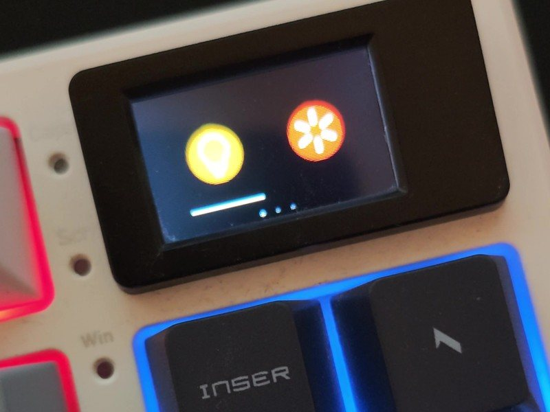
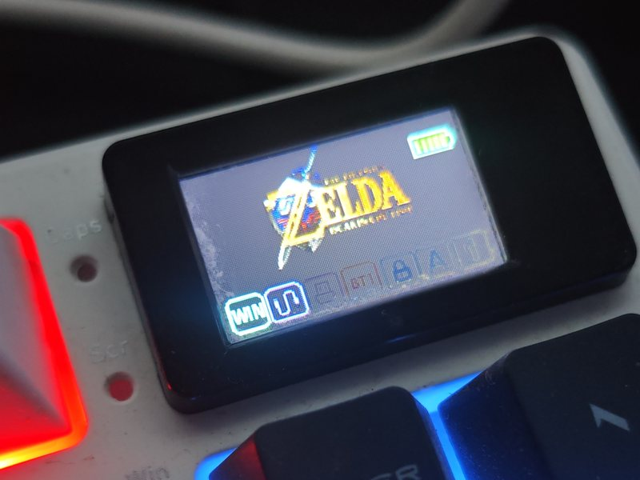
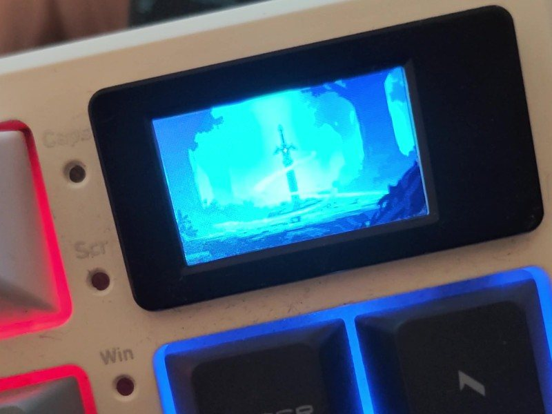
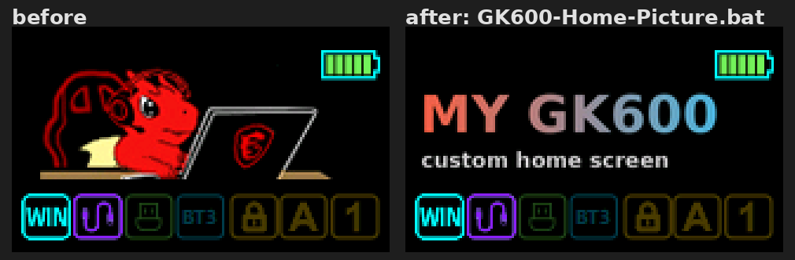
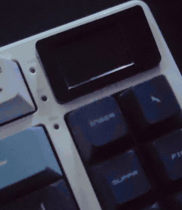
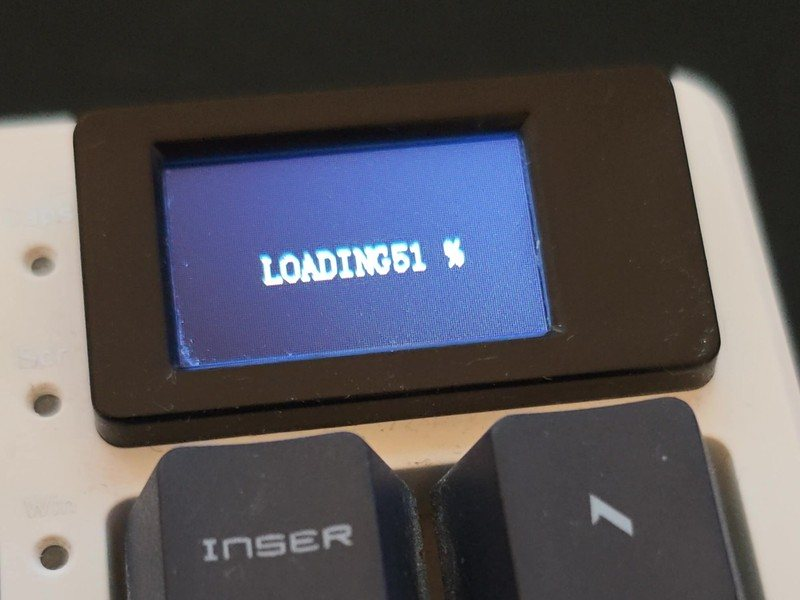

# GK600 — outils de l'écran / screen tools

← [Page principale](../README.fr.md) · [Main page](../README.md)

**Expérimental / experimental.** Réparation complète confirmée sur un GK600 TKL Wireless abîmé
(firmware V1.04), image d'accueil et animation de démarrage essayées sur un autre en V1.20, après
validation en émulation sur le vrai code du firmware. Full repair confirmed on a damaged GK600 TKL
Wireless (firmware V1.04), home picture and boot animation tried on another one running V1.20,
after validation in emulation against the real firmware code.

<table>
  <tr>
    <td align="center"><br><b>Réparer</b> · <i>Repair</i></td>
    <td align="center"><br><b>Image d'accueil</b> · <i>Home picture</i></td>
    <td align="center"><br><b>Animation de démarrage</b> · <i>Boot animation</i></td>
  </tr>
</table>

<p align="center"><br><sub>L'écran d'accueil d'origine et avec une image personnelle (aperçu de l'outil) · <i>The original home screen and with a custom picture (tool preview)</i></sub></p>

---

## 🇫🇷 Pour les débutants (Windows)

Pour tout : **téléchargez** ce dépôt (bouton vert **Code** → **Download ZIP**, puis clic droit
sur le ZIP → **Extraire tout**), **fermez le logiciel MSI** (aussi dans la zone de notification,
près de l'horloge) et branchez le clavier avec son **câble USB**, interrupteur sur **filaire**. Si
Windows affiche « Windows a protégé votre PC » en ouvrant un `.bat` : **Informations
complémentaires** → **Exécuter quand même**.

<a id="fr-repair"></a>
### Réparer les menus et l'animation MSI

**Le problème :** après l'envoi d'un très long GIF (avec `gif_maxframes` relevé au-delà de 255),
les menus de l'écran sont devenus noirs ou remplis d'images du GIF, parfois le logo MSI du
démarrage aussi. Une réinitialisation d'usine n'y change rien.

1. Ouvrez le dossier `restauration` et **double-cliquez sur `GK600-Repair.bat`**.
2. **Suivez les instructions** de la fenêtre. Elle télécharge ce qu'il faut (un Python portable et
   la sauvegarde de référence, empreintes vérifiées ; rien n'est installé), vérifie le clavier,
   vous fait le redémarrer, puis remet les images d'origine (2 à 3 minutes). Votre GIF n'est pas
   touché.
3. Éteignez le clavier 10 secondes et rallumez-le : l'animation MSI et les menus sont revenus.

<a id="fr-home"></a>
### Changer l'image de l'écran d'accueil

Glissez une image PNG ou JPG sur **`GK600-Home-Picture.bat`**. Un aperçu s'ouvre avant toute
écriture (environ 1 minute ensuite). Zone affichée : 160 × 65 pixels, au-dessus de la barre
d'icônes ; la batterie s'affiche par-dessus le coin en haut à droite, gardez-le vide. Pour
remettre le dragon : `GK600-Repair.bat`.

<a id="fr-boot"></a>
### Changer l'animation de démarrage



Glissez un GIF, ou une image PNG ou JPG, sur **`GK600-Boot-Animation.bat`**. La fenêtre montre un
aperçu de ce que l'écran va jouer avant toute écriture, vous propose de garder votre propre image
d'accueil si vous en avez mis une, puis écrit l'animation (1 à 3 minutes).

- Écran de 160 × 96 pixels : l'image est ajustée sur fond noir.
- 72 images au maximum : au-delà, l'outil saute des images en gardant la durée totale.
- Les durées du GIF sont respectées. La première image reste une demi-seconde de plus, la dernière
  reste 1 seconde, puis l'écran d'accueil s'affiche.
- Pour remettre l'animation MSI : `GK600-Repair.bat`.

<br clear="right">

### Pour que ça n'arrive plus

Laissez `gif_maxframes` à **255** dans `rgb-keyboard.xml` (145 images par GIF au plus, par
prudence).

---

## 🇬🇧 For beginners (Windows)

For everything: **download** this repository (green **Code** button → **Download ZIP**, then
right-click the ZIP → **Extract All**), **close MSI's software** (check the system tray too, next
to the clock) and plug the keyboard in with its **USB cable**, switch set to **wired**. If Windows
shows "Windows protected your PC" when you open a `.bat`: **More info** → **Run anyway**.

<a id="en-repair"></a>
### Repair the menus and the MSI animation

**The problem:** after uploading a very long GIF (with `gif_maxframes` raised above 255), the
screen menus went black or got filled with GIF frames, sometimes the MSI boot logo too. A factory
reset does not help.

1. Open the `restauration` folder and **double-click `GK600-Repair.bat`**.
2. **Follow the prompts.** The window downloads what it needs (a portable Python and the reference
   backup, all hash-checked; nothing gets installed), checks the keyboard, has you restart it,
   then puts the original pictures back (2 to 3 minutes). Your GIF is not touched.
3. Switch the keyboard off for 10 seconds and back on: the MSI animation and the menus are back.

<a id="en-home"></a>
### Change the home-screen picture

Drag a PNG or JPG onto **`GK600-Home-Picture.bat`**. A preview opens before anything is written
(about 1 minute after that). Shown area: 160 × 65 pixels, above the icon bar; the battery is drawn
over the top-right corner, so keep it empty. To get the dragon back: `GK600-Repair.bat`.

<a id="en-boot"></a>
### Change the boot animation


Drag a GIF, or a PNG or JPG picture, onto **`GK600-Boot-Animation.bat`**. The window shows a
preview of what the screen will play before anything is written, offers to keep your own home
picture if you set one, then writes the animation (1 to 3 minutes).

- 160 × 96 pixel screen: the picture is fitted on a black background.
- 72 frames at most: beyond that, the tool skips frames and keeps the total time.
- The GIF's frame times are kept. The first frame stays half a second longer, the last one stays
  1 second, then the home screen shows.
- To get the MSI animation back: `GK600-Repair.bat`.

<br clear="right">

### To keep it from happening again

Leave `gif_maxframes` at **255** in `rgb-keyboard.xml` (145 frames per GIF at most, to be safe).

---

## Comment ça marche / how it works



Le clavier range son GIF dans la puce de l'écran à une adresse fixe sans jamais vérifier où la
puce se termine : un GIF d'environ 420 images ou plus déborde et repart au début de la puce, là où
sont toutes les images des menus, puis l'animation de démarrage. Les outils parlent au clavier en
USB avec les mêmes commandes que le logiciel MSI et réécrivent ces zones à partir de la sauvegarde
publique d'un GK600 qui marche ([Flonfli/Forge-gk600-tkl-wireless.bin](https://github.com/Flonfli/Forge-gk600-tkl-wireless.bin)),
avec votre image ou votre animation à la place de celles de MSI. Rien à ouvrir, aucun flashage de
firmware, la zone du GIF n'est jamais touchée. Pendant l'écriture, l'écran du clavier affiche
lui-même « LOADING xx % ».

The keyboard stores its GIF in the screen's flash chip at a fixed address and never checks where
the chip ends: a GIF of about 420 frames or more runs past the end and wraps around to the start
of the chip, where every menu picture lives, then the boot animation. The tools talk to the
keyboard over USB with the same commands as MSI's software and rewrite those areas from the public
backup of a working GK600, with your picture or animation in place of MSI's. Nothing to open, no
firmware flashing, the GIF area is never touched. While writing, the keyboard screen itself shows
"LOADING xx %".

<br clear="right">

## Validé sur de vrais claviers / validated on real keyboards

| Date | Firmware | Résultat / result |
|---|---|---|
| 18/11/2026 | V1.20 | contrôle du clavier, sonde de 17 pages et retour, image d'accueil (384 pages) / keyboard check, 17-page probe and undo, home picture (384 pages) |
| 19/11/2026 | V1.04 | clavier abîmé : réparation complète, menus et animation MSI revenus, GIF intact / damaged keyboard: full repair, menus and MSI animation back, GIF untouched |
| 22/11/2026 | V1.20 | deux animations de démarrage (36 images / 687 pages, 53 images / 814 pages), jouées à l'allumage (filmé), image d'accueil gardée, menus et GIF intacts / two boot animations (36 frames / 687 pages, 53 frames / 814 pages), played at power-on (filmed), home picture kept, menus and GIF intact |

Si votre firmware n'est ni V1.04 ni V1.20, `GK600-Repair.bat` fait d'abord un test réversible de
3 secondes et s'arrête s'il ne se comporte pas pareil ; l'image d'accueil et l'animation de
démarrage refusent de démarrer tant que la version n'est pas validée. If your firmware is neither
V1.04 nor V1.20, `GK600-Repair.bat` first runs a 3-second reversible test and stops if it does not
behave the same; the home picture and boot animation refuse to run until your version is
validated. Please report your result in the **Issues** tab.

## Guides détaillés / detailed guides

- Français : [RESTAURATION_MENUS.md](RESTAURATION_MENUS.md)
- English: [RESTORE_MENUS.md](RESTORE_MENUS.md)
- Technical reference: [../TECHNICAL.md](../TECHNICAL.md)

Manual use (Python 3.8+ and `pip install hidapi`, the dump `Forge gk600 tkl wireless.bin` next to
the scripts):

```
python gk600_restore.py check                         # no write
python gk600_restore.py probe --write                 # 17 pages, striped icons, reversible
python gk600_restore.py unprobe --write
python gk600_restore.py restore --write               # menus, 416 pages
python gk600_restore.py restore --with-boot --write   # menus + boot animation, 960 pages
python gk600_home_picture.py picture.png --preview preview.png   # needs: pip install pillow
python gk600_home_picture.py picture.png --write      # home picture, 384 pages
python gk600_boot_animation.py anim.gif --preview preview.gif   # needs: pip install pillow
python gk600_boot_animation.py anim.gif --write       # boot animation, up to 957 pages
python gk600_boot_animation.py anim.gif --home picture.png --write   # and keep your home picture
python gk600_boot_animation.py anim.gif --fill --write   # crop to fill the screen instead of fitting
```

## Fichiers / files

| File | Role |
|---|---|
| `GK600-Repair.bat` | double-click: repair menus and boot animation / réparation |
| `GK600-Home-Picture.bat` | drop a picture on it: home-screen picture / image d'accueil |
| `GK600-Boot-Animation.bat` | drop a GIF on it: boot animation / animation de démarrage |
| `gk600_easy.ps1` | what the three `.bat` files run: downloads (SHA-256 checked), prompts |
| `gk600_restore.py` | the restore tool (check, probe, unprobe, restore) |
| `gk600_home_picture.py` | the home-screen picture tool |
| `gk600_boot_animation.py` | the boot animation tool |
| `images/reference_screens_0_1A0000.png` | the 41 original menu screens, to compare after a repair |
| `images/probe_preview.png` | home screen before and after the probe |
| `images/home_picture_example.png` | home screen before and after a custom picture |
| `tests/` | emulator, replayable scenarios, results, logs of the real-keyboard sessions |

*Community tool, not affiliated with MSI. Use at your own risk.*
