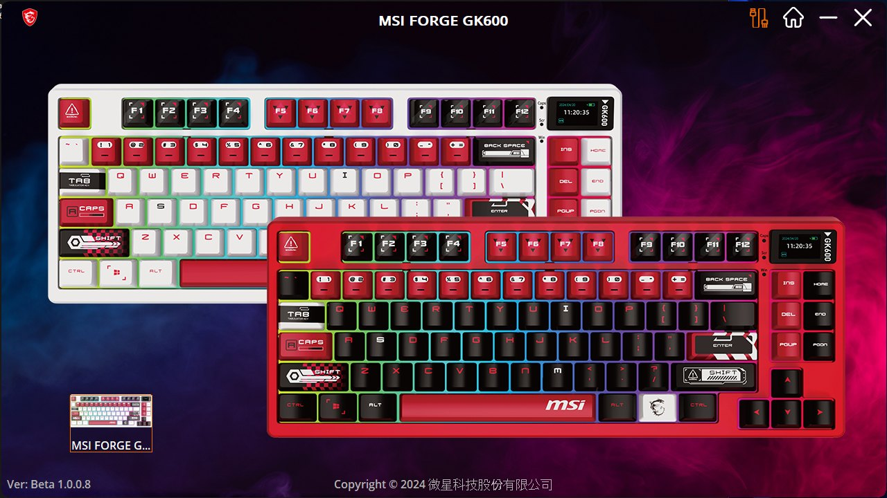
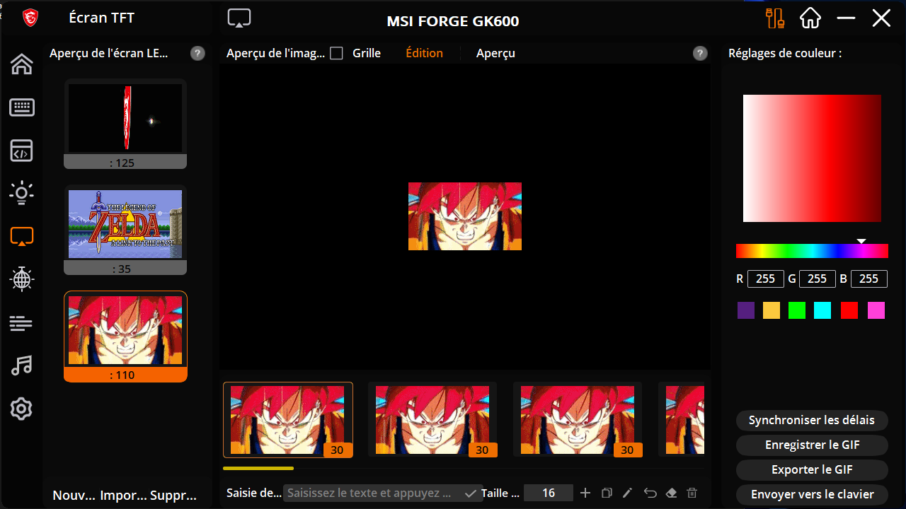
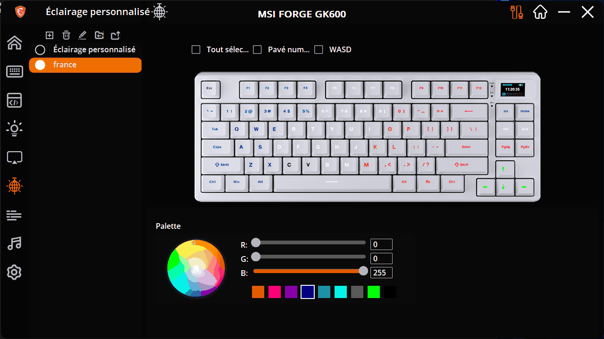
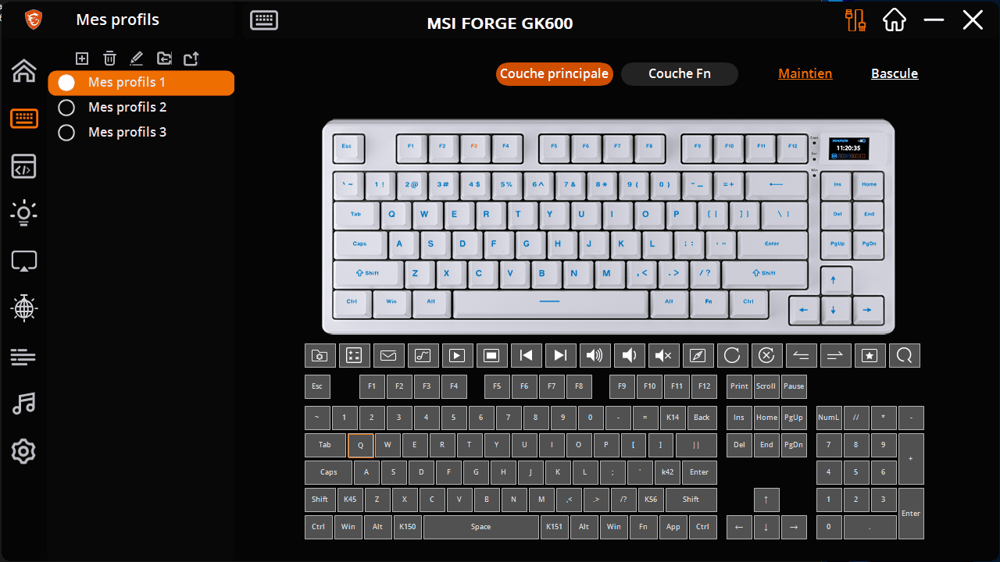
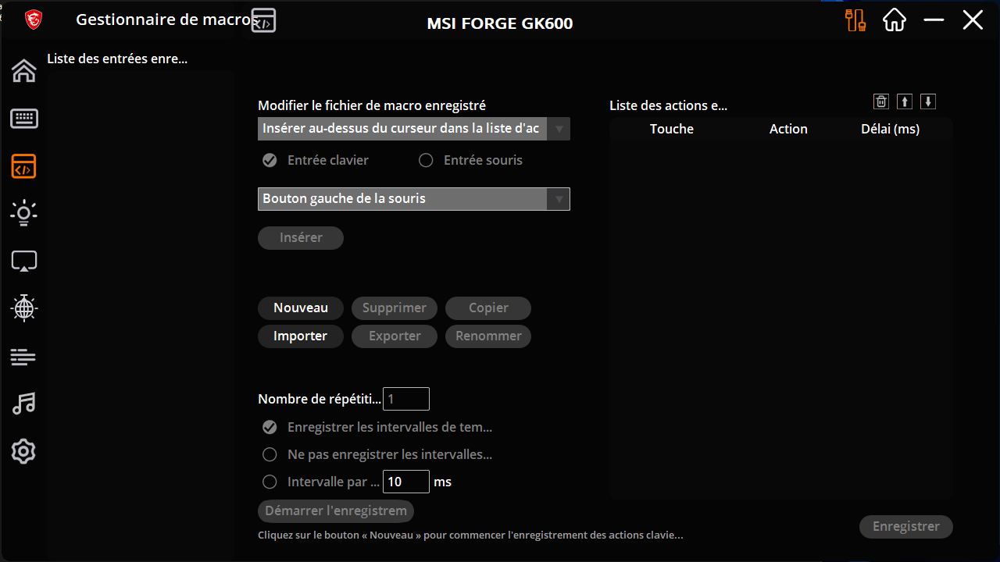

# Logiciel MSI en français

← [Page principale](../README.fr.md) · [Main page](../README.md)

*French translation of the MSI GK600 software (`DeviceDriver.exe`). Instructions below are in French.*

Traduction française complète du logiciel du clavier (`DeviceDriver.exe`, installé sous le nom « Erazer MK85Pro Driver »). Une fois installée, elle apparaît comme une langue normale dans **Paramètres > Langue**.

<table>
  <tr>
    <td align="center"> Accueil</td>
    <td align="center"> Écran TFT : vos GIF</td>
  </tr>
  <tr>
    <td align="center"> Éclairage personnalisé : RGB touche par touche</td>
    <td align="center"> Mes profils : réaffectation des touches</td>
  </tr>
  <tr>
    <td align="center" colspan="2"> Gestionnaire de macros</td>
  </tr>
</table>

## Installation

1. **Fermez le logiciel du clavier**, y compris son icône près de l'horloge de Windows.
2. Récupérez les 3 fichiers de ce dossier et gardez-les ensemble : `1036.lan`, `installer_fr.ps1` et `INSTALLER_FR.bat`. Le plus simple : bouton vert **Code > Download ZIP** du dépôt, puis ouvrez le dossier `traduction-fr`.
3. Double-cliquez sur **`INSTALLER_FR.bat`** et acceptez la demande d'administrateur.
4. Relancez le logiciel : il est en français.

> 💡 **Vous lancez le logiciel depuis une copie (astuce du tuto, sur le Bureau) ?** Le script trouve tout seul les copies posées sur le Bureau. Si votre copie est ailleurs, mettez les 3 fichiers à côté de `DeviceDriver.exe` et lancez `INSTALLER_FR.bat` depuis ce dossier : seul ce dossier sera traité.

## Ce que fait le script

- Il copie `1036.lan` dans le dossier `language` du logiciel, au format que le logiciel exige (UTF-16 avec BOM), quel que soit le format du fichier fourni.
- Il sauvegarde `config.xml` (`config.xml.bak-<date>`), puis ajoute le français à la liste des langues et le met par défaut. Les autres lignes ne sont pas touchées, dont le correctif USB `product_name` du tuto.
- Il règle la langue sur le français dans le registre (`HKCU\Software\Erazer MK85Pro Driver`, valeur `LCID`).

Dossiers traités : `C:\Program Files (x86)\MSI FORGE GK600`, `C:\Program Files (x86)\Womier SK80 PRO Driver` et les copies du logiciel posées sur le Bureau. Si le script est à côté de `DeviceDriver.exe`, seul ce dossier est traité.

## Revenir en anglais

Dans le logiciel : **Paramètres > Langue > English**. Ou remettez `config.xml.bak-<date>` à la place de `config.xml` et supprimez `language\1036.lan`.

## Le bouton « Régler l'heure »

Sur la page de l'écran, le bouton **« Régler l'heure »** (« Time Syns » en anglais) met le clavier à l'heure du PC. Le logiciel le fait aussi tout seul quand il renvoie ses réglages au clavier.

Sur la GK600 TKL, l'heure ne s'affiche pas : le firmware la reçoit mais ne la dessine pas. Le seul effet visible, c'est que l'écran repasse sur l'accueil (le dragon). Pour revenir à votre GIF : **Fn + flèche gauche / droite**.

## Modifier la traduction

`1036.lan` est un fichier texte : une ligne `numéro=texte` par élément de l'interface. Vous pouvez l'éditer avec le Bloc-notes, puis relancer `INSTALLER_FR.bat`, qui le convertit au bon format. Évitez de le copier à la main dans `language` après l'avoir enregistré en UTF-8 : le logiciel afficherait les accents de travers.

---

*Traduction communautaire, non affiliée à MSI. Utilisée avec le driver 1.0.0.8 sur un GK600 TKL WIRELESS (firmware V1.20).*
