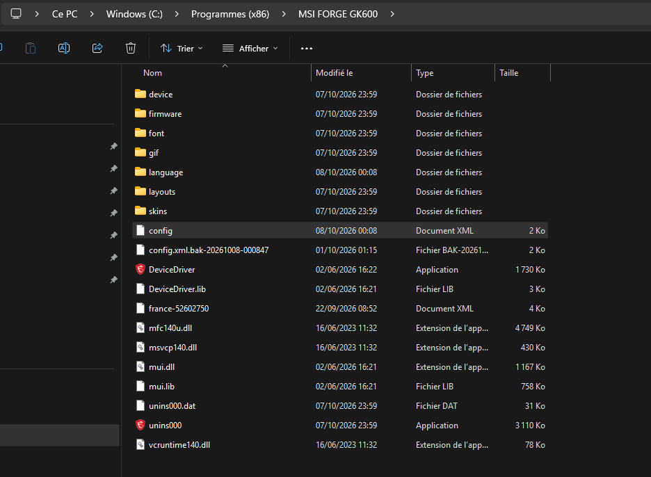
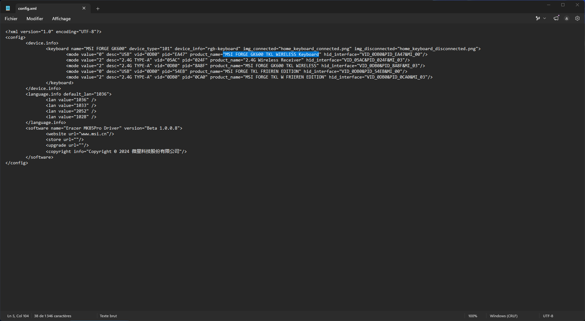
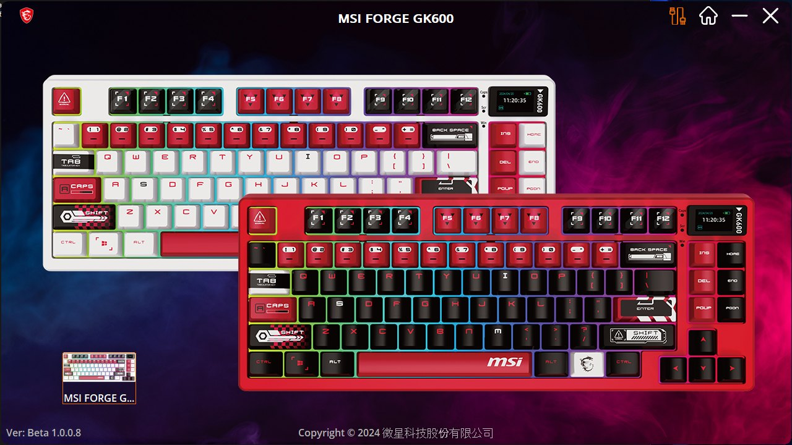
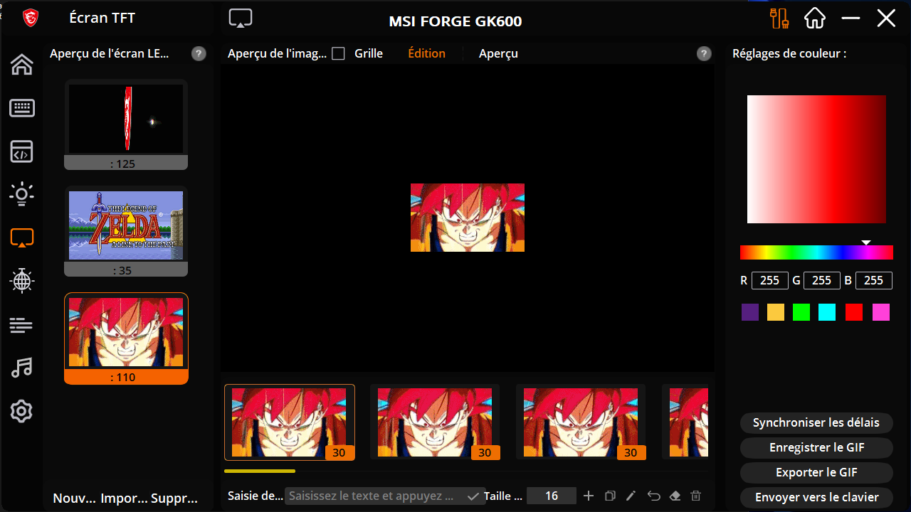
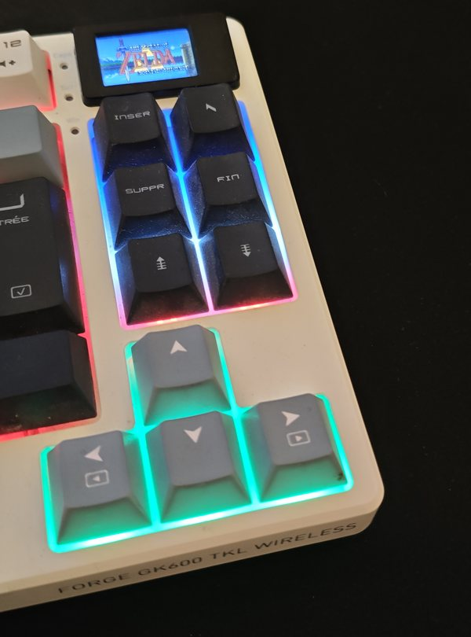
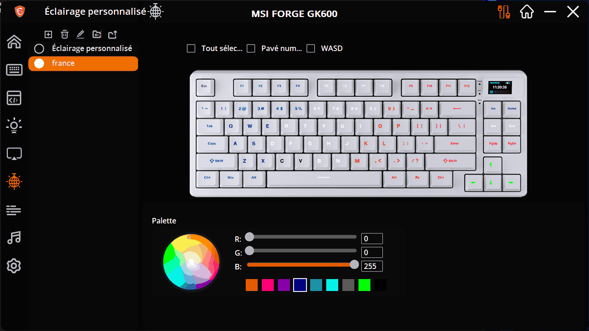

# Afficher vos propres GIF sur l'écran du MSI Forge GK600 TKL (en USB)

🇬🇧 **[English version](tutorial-gk600-gif-usb.md)** · ← [Retour à la page principale](README.fr.md)

> **Ce que ce tuto débloque :** le MSI Forge GK600 TKL est vendu comme « sans logiciel », avec
> seulement des animations pré-chargées qu'on choisit depuis le clavier. En réalité, un logiciel
> MSI permet de **téléverser vos propres GIF** sur le petit écran et de **régler le RGB touche par
> touche**. Problème : par défaut, ce logiciel ne reconnaît pas le clavier quand il est branché en
> USB. Ce guide corrige ça en modifiant **une seule ligne** dans un fichier : aucun flashage,
> aucun risque pour le clavier.

> 🛠️ **Envie d'aller plus loin ?** Remplacer l'image de l'écran d'accueil ou l'animation de
> démarrage MSI, ou réparer des menus effacés par un long GIF : dossier
> [`restauration/`](restauration/README.md).

**Temps nécessaire :** ~15 minutes. **Niveau :** débutant, on détaille tout.
**Il vous faut :** un PC Windows (10 ou 11), le câble USB-C fourni, et le clavier.

---

## 1. Télécharger le logiciel

> ℹ️ **Où le trouver :** MSI retire peu à peu le téléchargement de ses pages produit (d'abord les
> pages du GK600 TKL « classiques », SKY / Violet). Le fichier reste disponible sur le **serveur
> de téléchargement officiel de MSI** : passez par le lien direct ci-dessous. C'est le même paquet
> que celui de la page **FORGE TKL WIRELESS FRIEREN EDITION**, et il couvre aussi le GK600
> standard (les deux modèles sont déclarés dans sa configuration).

1. Téléchargez le **Driver 1.0.0.8** (≈ 6,1 Mo, daté du 2026-06-08) directement sur le serveur de
   MSI :
   **https://download.msi.com/dvr_exe/gear/MSI-FORGE-GK600-Driver-1.0.0.8.zip**
2. Vérifiez son empreinte SHA-256 (encadré ci-dessous) avant de l'ouvrir.

> ⚠️ **N'utilisez pas MSI Center** pour cette manip. MSI Center ne reconnaît pas l'écran du
> clavier. C'est le petit logiciel du paquet ci-dessus (son exécutable s'appelle
> `DeviceDriver.exe`) qui gère le GIF et le RGB.
>
> 🔒 **Vérifier l'intégrité (facultatif mais conseillé) :** le SHA-256 du paquet Driver 1.0.0.8
> affiché par MSI est
> `73252a3d361f6b09d5c8c7153279c37725b9ccb83f129f92e1d8d2faeef0ec59`.
> Sous Windows : `certutil -hashfile "le-fichier.zip" SHA256` doit renvoyer exactement cette
> valeur.
>
> 💡 Le « FW Update Tool » v1.17 que MSI proposait à côté est un **flasheur de firmware** :
> **inutile pour afficher un GIF**, et à réserver aux utilisateurs avertis. Pour ce tuto, seul le
> **Driver** est nécessaire.

---

## 2. Installer

1. Faites un clic droit sur le ZIP → **Extraire tout**.
2. Lancez l'installateur et suivez les étapes (Suivant → Suivant → Installer).
3. Le logiciel s'installe sous le nom **« Erazer MK85Pro Driver »** — **c'est normal** (c'est le
   nom OEM interne, le GK600 partage sa plateforme avec d'autres claviers).
4. Notez le dossier d'installation (en général `C:\Program Files (x86)\MSI FORGE GK600`). On va en
   avoir besoin à l'étape 3.

<p align="center"><br><sub>Le dossier d'installation : <code>config.xml</code> est le fichier à corriger, <code>DeviceDriver.exe</code> le logiciel.</sub></p>

---

## 3. La correction qui fait tout marcher (⭐ l'étape clé)

Le logiciel reconnaît le clavier en comparant le **nom** que le clavier annonce à Windows avec un
nom écrit dans son fichier de config. MSI y a mis **le mauvais nom** pour le mode USB → le clavier
n'est jamais reconnu en filaire (alors qu'en sans-fil 2.4G, ça passe). On remplace juste ce nom.

**Astuce débutant pour éviter les soucis de droits Windows :** copiez d'abord tout le dossier
d'installation sur votre **Bureau**, et travaillez sur cette copie. Vous lancerez le logiciel
depuis le Bureau.

1. Dans le dossier (celui du Bureau), ouvrez le fichier **`config.xml`** avec le **Bloc-notes**
   (clic droit → Ouvrir avec → Bloc-notes).
2. **Faites d'abord une copie de sauvegarde** de `config.xml` (copier/coller dans le même dossier,
   ça crée `config - Copie.xml`). Sécurité.
3. Dans le Bloc-notes, faites **Ctrl+F** et cherchez : `desc="USB"`
4. Vous tombez sur une ligne qui ressemble à ça :

   ```xml
   <mode value="0" desc="USB" vid="0DB0" pid="EA47" product_name="MSI FORGE GK600 GAMING KEYBOARD" hid_interface="VID_0DB0&PID_EA47&MI_00"/>
   ```

5. Remplacez **uniquement** le texte entre les guillemets de `product_name` par :

   ```
   MSI FORGE GK600 TKL WIRELESS Keyboard
   ```

   La ligne corrigée :

   ```xml
   <mode value="0" desc="USB" vid="0DB0" pid="EA47" product_name="MSI FORGE GK600 TKL WIRELESS Keyboard" hid_interface="VID_0DB0&PID_EA47&MI_00"/>
   ```

   > Ne touchez à **rien d'autre** sur la ligne (ni le `vid`, ni le `pid`, ni le
   > `hid_interface`). Laissez `MI_00` tel quel : le logiciel bascule tout seul sur le bon canal.

6. **Enregistrez** (Ctrl+S) et fermez.

<p align="center"><br><sub>La ligne <code>desc="USB"</code> avec le <code>product_name</code> corrigé.</sub></p>

### Si votre clavier n'est toujours pas reconnu après ça

Le nom exact peut varier d'un exemplaire ou d'une version de firmware à l'autre. Dans ce cas,
lisez le nom **de votre propre clavier** et recopiez-le à l'identique :

- Branchez le clavier en USB, puis ouvrez le **Gestionnaire de périphériques** (clic droit sur le
  menu Démarrer → Gestionnaire de périphériques).
- Dépliez **Claviers** (ou **Périphériques d'interface utilisateur**), repérez l'entrée du GK600.
- Clic droit → **Propriétés** → onglet **Détails** → dans la liste déroulante, choisissez
  **« Description de périphérique signalée par le bus »**.
- Le texte affiché est le nom à recopier **exactement** (espaces et majuscules compris) dans
  `product_name`.
- *(Plus fiable encore : l'outil gratuit « USB Device Tree Viewer » affiche le champ « iProduct »,
  qui est le nom exact attendu.)*

---

## 4. Brancher le clavier en USB et vérifier

1. Sur la tranche du clavier, mettez l'interrupteur à **3 positions** sur le mode **filaire / USB**
   (pas 2.4G, pas Bluetooth).
2. Branchez le câble **USB-C** du clavier au PC. L'écran du clavier doit s'allumer.
3. Lancez **`DeviceDriver.exe`** (dans le dossier du Bureau).
4. Le clavier doit maintenant apparaître dans le logiciel. 🎉

<p align="center"><br><sub>Le logiciel voit le clavier (ici avec la <a href="traduction-fr/README.md">traduction française</a>).</sub></p>

---

## 5. Téléverser votre GIF

1. Préparez votre GIF au bon format pour l'écran :
   - **Dimensions : 160 × 96 pixels** (c'est la taille exacte de l'écran).
   - **255 images (frames) maximum**, 145 ou moins par prudence. Pour une lecture fluide,
     privilégiez un GIF court (quelques dizaines d'images suffisent).
   - ⚠️ **Ne relevez jamais `gif_maxframes`** dans `rgb-keyboard.xml` : au-delà d'environ
     420 images, le GIF déborde de la mémoire de l'écran et efface les menus (réparation : dossier
     [`restauration/`](restauration/README.md)).
2. Dans le logiciel, ouvrez la page **Écran TFT**.
3. Cliquez sur **Importer** (en bas à gauche) et choisissez votre GIF, puis sur **Envoyer vers le
   clavier** (à droite).
4. Patientez pendant l'envoi (la barre progresse ; l'image fait quelques Mo). L'écran affiche
   ensuite votre GIF. L'écran d'accueil (le dragon) n'est pas effacé : **Fn + flèche gauche /
   droite** pour passer de l'un à l'autre.

<p align="center"><br><sub>La page <b>Écran TFT</b> : liste des GIF à gauche, images en bas, <b>Envoyer vers le clavier</b> à droite.</sub></p>

<p align="center"></p>

> 💡 Pour recadrer/redimensionner un GIF en 160×96 sans logiciel compliqué : un site comme
> ezgif.com (Resize) fait le travail gratuitement.

---

## 6. (Bonus) RGB touche par touche

Toujours dans le même logiciel, la page **Éclairage personnalisé** permet de choisir la couleur
**de chaque touche individuellement**, en plus des effets prédéfinis. Même principe : on règle,
puis on applique.

<p align="center"><br><sub>L'éclairage touche par touche.</sub></p>

---

## 7. (Bonus) Logiciel en français

Une traduction française complète du logiciel est fournie dans le dossier
[`traduction-fr/`](traduction-fr/README.md) : fermez le logiciel, double-cliquez sur
`INSTALLER_FR.bat`, acceptez la demande d'administrateur, puis relancez. Les copies du logiciel
posées sur le Bureau (astuce de l'étape 3) sont traitées aussi. Détails et retour en arrière :
[`traduction-fr/README.md`](traduction-fr/README.md).

---

## En cas de pépin

| Symptôme | Solution |
|---|---|
| Le clavier n'apparaît pas | Vérifiez l'interrupteur sur **USB filaire**, pas 2.4G/BT. |
| Toujours pas reconnu | Avez-vous bien modifié la ligne **`desc="USB"`** (et pas celle du 2.4G) ? Le `product_name` doit être **identique au caractère près**. |
| Impossible d'enregistrer `config.xml` | Vous l'éditez dans `Program Files` → Windows bloque. Utilisez la **copie sur le Bureau** (méthode de l'étape 3). |
| L'écran reste éteint | Il s'allume en mode **filaire USB** ; vérifiez le câble et l'interrupteur. |
| MSI Center ne voit rien | Normal. Utilisez **`DeviceDriver.exe`**, pas MSI Center. |
| Le nom ne marche pas | Lisez le nom réel de votre clavier (fin de l'étape 3) et recopiez-le. |
| Le driver n'est plus sur les pages MSI | Normal depuis fin 2026 : prenez-le avec le **lien direct** de l'étape 1 (serveur officiel MSI), puis vérifiez le SHA-256. |
| Le GIF a disparu, l'écran d'accueil est revenu | Le logiciel remet le clavier à l'heure (bouton « Régler l'heure », ou tout seul quand il renvoie ses réglages), et ça ramène l'écran sur l'accueil. **Fn + flèche gauche / droite** pour revenir au GIF. |
| Menus de l'écran ou logo MSI noirs après un long GIF | Double-cliquez sur `restauration/GK600-Repair.bat` (voir [`restauration/`](restauration/README.md)). |

---

## Pourquoi ça marche (pour les curieux)

Le clavier annonce à Windows le nom `MSI FORGE GK600 TKL WIRELESS Keyboard`. Le logiciel, lui,
cherchait `MSI FORGE GK600 GAMING KEYBOARD` : aucune correspondance, donc « aucun périphérique » en
USB. En 2.4G, le nom cherché était un préfixe correct du vrai nom, d'où un sans-fil qui a toujours
fonctionné. En alignant le nom, le logiciel ouvre enfin son canal de commande en USB. **Le
firmware du clavier est parfaitement fonctionnel — il n'y a jamais eu besoin de le modifier.**
Plus de détails (en anglais) : [TECHNICAL.md](TECHNICAL.md).

---

*Tuto communautaire, non affilié à MSI. Procédure vérifiée sur un GK600 TKL WIRELESS (firmware
V1.20) avec le driver 1.0.0.8. La modification est entièrement réversible (restaurez votre
`config.xml` de sauvegarde).*
