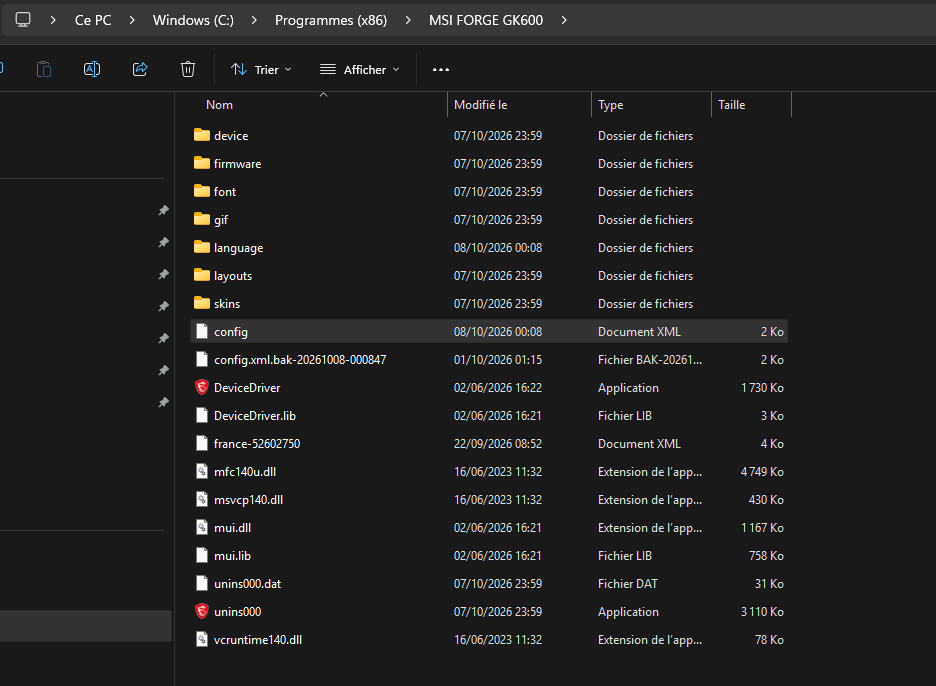
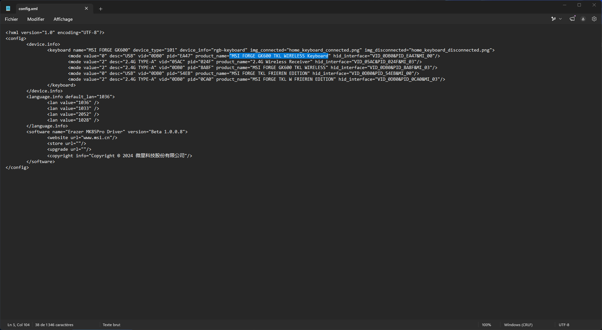
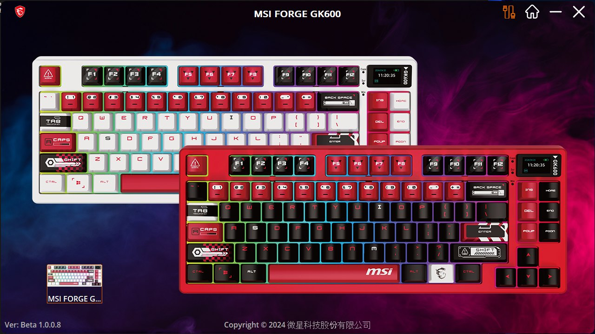
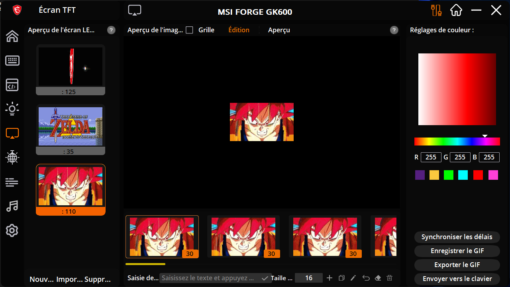
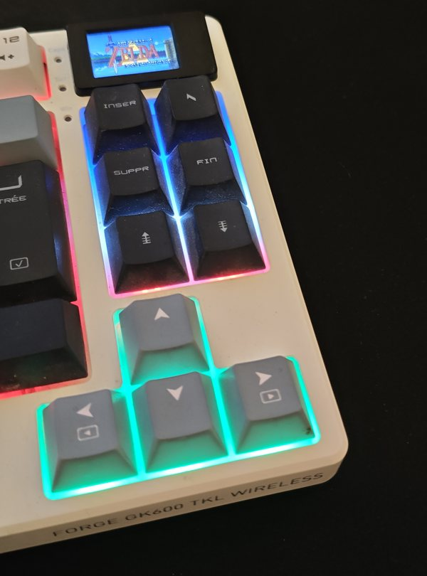
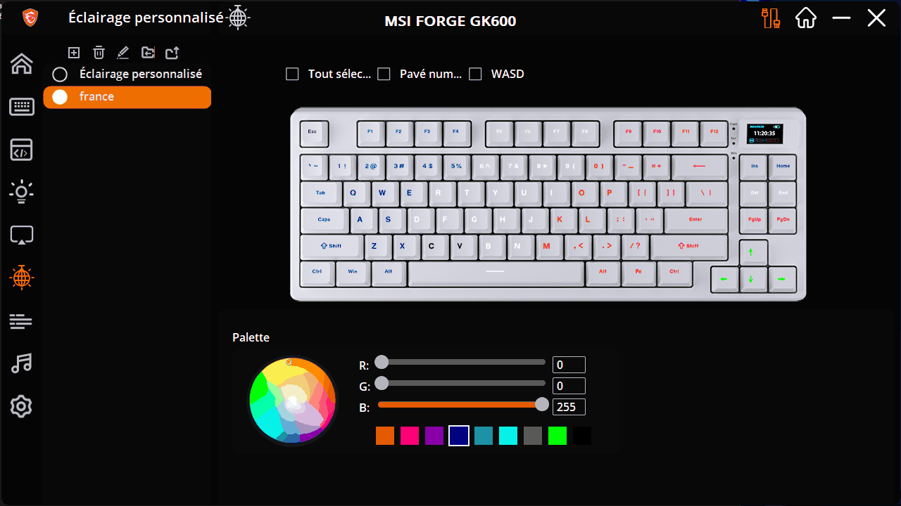

# Show your own GIFs on the MSI Forge GK600 TKL screen (over USB)

🇫🇷 **[Version française](tuto-gk600-gif-usb.md)** · ← [Back to the main page](README.md)

> **What this guide unlocks:** the MSI Forge GK600 TKL is sold as "no software needed", with only
> the built-in animations you pick from the keyboard. In fact, an MSI program lets you **upload
> your own GIFs** to the small screen and set **per-key RGB**. The catch: out of the box, that
> program doesn't recognise the keyboard when it's plugged in over USB. This guide fixes that by
> changing **one line** in a file: no flashing, no risk for the keyboard.

> 🛠️ **Want to go further?** Replace the home-screen picture or the MSI boot animation, or repair
> menus wiped by a long GIF: see [`restauration/`](restauration/README.md).

**Time needed:** about 15 minutes. **Level:** beginner, every step is detailed.
**You need:** a Windows 10 or 11 PC, the USB-C cable that came with the keyboard, and the keyboard.

---

## 1. Download the driver

MSI keeps removing the download from its product pages (first the "plain" GK600 TKL pages, SKY /
Violet), but the package is still on **MSI's official download server**. It's the same package
that was listed on the **FORGE TKL WIRELESS FRIEREN EDITION** support page, and it covers the
standard GK600 too (both models are declared in its configuration).

1. Download the **Driver 1.0.0.8** straight from MSI's server:
   **https://download.msi.com/dvr_exe/gear/MSI-FORGE-GK600-Driver-1.0.0.8.zip**
2. Check its SHA-256 before opening it. In a command prompt:
   `certutil -hashfile "MSI-FORGE-GK600-Driver-1.0.0.8.zip" SHA256`

| File | Version | Date | Size | SHA-256 |
|---|---|---|---|---|
| **Driver** (needed) | 1.0.0.8 | 2026-06-08 | 6.10 MB | `73252a3d361f6b09d5c8c7153279c37725b9ccb83f129f92e1d8d2faeef0ec59` |
| FW Update Tool (*not* needed) | 1.17 | 2026-06-25 | 1.02 MB | `c75112f78c893e755f66c033e7022b71719ade4c4b3e655f34e1886fd0c37639` |

> ⚠️ **Don't use MSI Center** for this. MSI Center doesn't see the keyboard's screen. The program
> that handles the GIF and the RGB is the small one in the package above: `DeviceDriver.exe`.
>
> 💡 The "FW Update Tool" that MSI offered next to it is a **firmware flasher**: you don't need it
> to show a GIF, and it's best left to experienced users.

---

## 2. Install

1. Right-click the ZIP → **Extract All**.
2. Run the installer and follow the steps (Next → Next → Install).
3. The program installs as **"Erazer MK85Pro Driver"**: **that's normal** (it's the internal OEM
   name; the GK600 shares its platform with other keyboards).
4. Note the install folder (usually `C:\Program Files (x86)\MSI FORGE GK600`). You'll need it in
   step 3.

<p align="center"><br><sub>The install folder: <code>config.xml</code> is the file to fix, <code>DeviceDriver.exe</code> is the program.</sub></p>

---

## 3. The fix that makes it work (⭐ key step)

The program recognises the keyboard by comparing the **name** the keyboard reports to Windows with
a name written in its configuration file. MSI put **the wrong name** there for USB mode, so the
keyboard is never recognised over the cable (while 2.4G wireless works). You just replace that
name.

**Beginner tip to avoid Windows permission trouble:** first copy the whole install folder to your
**Desktop** and work on that copy. You'll launch the program from the Desktop.

1. In the folder (the one on the Desktop), open **`config.xml`** with **Notepad** (right-click →
   Open with → Notepad).
2. **Make a backup copy** of `config.xml` first (copy and paste in the same folder, which creates
   `config - Copy.xml`).
3. In Notepad, press **Ctrl+F** and search for: `desc="USB"`
4. You land on a line like this:

   ```xml
   <mode value="0" desc="USB" vid="0DB0" pid="EA47" product_name="MSI FORGE GK600 GAMING KEYBOARD" hid_interface="VID_0DB0&PID_EA47&MI_00"/>
   ```

5. Replace **only** the text between the quotes of `product_name` with:

   ```
   MSI FORGE GK600 TKL WIRELESS Keyboard
   ```

   The fixed line:

   ```xml
   <mode value="0" desc="USB" vid="0DB0" pid="EA47" product_name="MSI FORGE GK600 TKL WIRELESS Keyboard" hid_interface="VID_0DB0&PID_EA47&MI_00"/>
   ```

   > Don't touch **anything else** on the line (not the `vid`, not the `pid`, not the
   > `hid_interface`). Leave `MI_00` as it is: the program switches to the right channel on its
   > own.

6. **Save** (Ctrl+S) and close.

<p align="center"><br><sub>The <code>desc="USB"</code> line with the fixed <code>product_name</code>.</sub></p>

### If your keyboard still isn't recognised

The exact name can vary from one unit or firmware version to another. In that case, read **your
own keyboard's** name and copy it exactly:

- Plug the keyboard in over USB, then open **Device Manager** (right-click the Start menu →
  Device Manager).
- Expand **Keyboards** (or **Human Interface Devices**) and find the GK600 entry.
- Right-click → **Properties** → **Details** tab → in the drop-down list, choose **"Bus reported
  device description"**.
- The text shown is the name to copy **exactly** (spaces and capitals included) into
  `product_name`.
- *(Even more reliable: the free tool "USB Device Tree Viewer" shows the "iProduct" field, which is
  the exact name expected.)*

---

## 4. Plug the keyboard in over USB and check

1. On the edge of the keyboard, set the **3-way switch** to **wired / USB** (not 2.4G, not
   Bluetooth).
2. Connect the keyboard's **USB-C** cable to the PC. The keyboard's screen should light up.
3. Launch **`DeviceDriver.exe`** (in the Desktop folder).
4. The keyboard now shows up in the program. 🎉

<p align="center"><br><sub>MSI's software sees the keyboard (shown here with the <a href="traduction-fr/README.md">French translation</a> installed).</sub></p>

---

## 5. Upload your GIF

1. Get your GIF in the right format for the screen:
   - **Size: 160 × 96 pixels** (the exact size of the screen).
   - **255 frames at most** (145 or fewer to be extra safe). A short GIF, a few dozen frames,
     plays smoothly.
   - ⚠️ **Never raise `gif_maxframes`** in `rgb-keyboard.xml`: past about 420 frames, the GIF
     overflows the screen's memory and wipes the menus (fix: [`restauration/`](restauration/README.md)).
2. In the program, open the **TFT Screen** page.
3. Click **Import** (bottom left) and pick your GIF, then **Upload to keyboard** (right).
4. Wait while it uploads (the bar fills up; the picture weighs a few MB). The screen then plays
   your GIF. The home screen (the dragon) isn't erased: **Fn + ← / →** switches between the two.

<p align="center"><br><sub>The <b>TFT Screen</b> page (French translation shown): GIF list on the left, frames at the bottom, <b>Upload to keyboard</b> on the right.</sub></p>

<p align="center"></p>

> 💡 To crop or resize a GIF to 160 × 96 without complicated software, a site like ezgif.com
> (Resize) does the job for free.

---

## 6. (Bonus) Per-key RGB

In the same program, the **User Lighting** page lets you pick the colour **of every key
individually**, on top of the built-in effects. Same idea: set it, then apply.

<p align="center"><br><sub>Per-key lighting (French translation shown).</sub></p>

---

## 7. (Bonus) The program in French

A complete French translation of the program is in [`traduction-fr/`](traduction-fr/README.md):
close the program, double-click `INSTALLER_FR.bat`, accept the administrator prompt, then launch
it again. Copies of the program on the Desktop (tip from step 3) are handled too.

---

## Troubleshooting

| Symptom | Fix |
|---|---|
| The keyboard doesn't show up | Check the switch is on **wired USB**, not 2.4G/BT. |
| Still not recognised | Did you edit the **`desc="USB"`** line (not the 2.4G one)? `product_name` must match **character for character**. |
| Can't save `config.xml` | You're editing it in `Program Files` and Windows blocks it. Use the **Desktop copy** (step 3). |
| The screen stays off | It lights up in **wired USB** mode; check the cable and the switch. |
| MSI Center sees nothing | Normal. Use **`DeviceDriver.exe`**, not MSI Center. |
| The name doesn't work | Read your keyboard's real name (end of step 3) and copy it. |
| The driver isn't on MSI's pages anymore | Normal since late 2026: use the **direct link** in step 1 (MSI's official server), then check the SHA-256. |
| The GIF is gone, the home screen is back | The program sets the keyboard's clock ("Time Syns" button, or on its own when it sends its settings), which brings the home screen back. **Fn + ← / →** to get back to the GIF. |
| Screen menus or MSI logo black after a long GIF | Double-click `restauration/GK600-Repair.bat` (see [`restauration/`](restauration/README.md)). |

---

## Why it works (for the curious)

The keyboard reports the name `MSI FORGE GK600 TKL WIRELESS Keyboard` to Windows. The program was
looking for `MSI FORGE GK600 GAMING KEYBOARD`: no match, so "no device" over USB. In 2.4G mode,
the name it looked for was a correct prefix of the real name, which is why wireless always worked.
Once the names match, the program finally opens its command channel over USB. **The keyboard's
firmware works perfectly: it never needed to be changed.** More details in
[TECHNICAL.md](TECHNICAL.md).

---

*Community guide, not affiliated with MSI. Verified on a GK600 TKL WIRELESS (firmware V1.20) with
driver 1.0.0.8. The change is fully reversible (put your backup `config.xml` back).*
